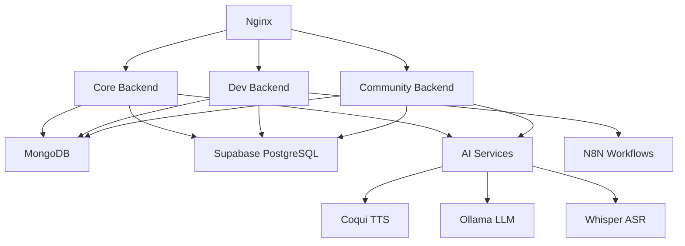

# KasaAI Platform Architecture

**Version**: 2.1
**Last Updated**: 2025-10-26
**Status**: Living Document

---

## Table of Contents

1. [Overview](#overview)
2. [Platform Philosophy](#platform-philosophy)
3. [Multi-App Architecture](#multi-app-architecture)
4. [Shared Services Design](#shared-services-design)
5. [Technology Stack](#technology-stack)
6. [Service Boundaries](#service-boundaries)
7. [Data Flow Patterns](#data-flow-patterns)
8. [Authentication & Authorization](#authentication--authorization)
9. [AI Services Architecture](#ai-services-architecture)
10. [Centralized TTS Service](#centralized-tts-service)
11. [TTS Lab Advanced Features (Sprint 4)](#tts-lab-advanced-features-sprint-4) ⭐ NEW
12. [Deployment Architecture](#deployment-architecture)
13. [Scaling Considerations](#scaling-considerations)

---

## Overview

KasaAI is a **multi-application platform** providing AI-powered services for African languages and communities. The platform consists of multiple independent applications sharing common backend services, infrastructure, and design patterns.

### Core Principles

1. **Backend Sharing, Frontend Independence**: Share backend logic, allow frontend flexibility
2. **Configuration Over Code**: Use environment-based configuration
3. **Type Safety**: Pydantic (backend) + TypeScript (frontend)
4. **Service-Oriented**: Clear boundaries between services
5. **Documentation-Driven**: Document patterns, don't enforce components

---

## Platform Philosophy

### What We Share

#### ✅ Backend Services (Code Sharing)
- AI Provider Management (TTS, LLM, ASR)
- RAG (Retrieval-Augmented Generation)
- Document Processing
- Wallet & Usage Tracking
- Health Monitoring
- Authentication Integration

#### ✅ React Hooks (Logic Sharing)
- `useAIProvider` - AI provider state management
- `useRAG` - RAG query hooks
- `useWallet` - Wallet operations
- `useAuth` - Supabase auth integration

#### ✅ Patterns & Documentation
- Component patterns (documented, not enforced)
- API contracts and standards
- Integration guides with code examples
- Testing patterns

### What We Don't Share

#### ❌ UI Components (App-Specific)
Different apps have different UX needs:
- `@apps/personal_tutor/` → Kid-friendly, gamified, colorful
- `@apps/b2c-portal/` → Professional, technical, data-focused
- `@apps/church_manager/` → Clean, accessible, community-focused
- `@apps/event_manager/` → Enterprise, calendar-focused, formal

**Rationale**: Shared UI components create:
- Build complexity (no hot-reload for changes)
- UX coupling (can't customize per-app)
- Breaking changes affecting multiple apps
- Framework lock-in

**Solution**: Document patterns in `COMPONENT_PATTERNS.md`, allow apps to copy and adapt.

---

## Multi-App Architecture

### Application Portfolio

```
┌─────────────────────────────────────────────────────────────┐
│                    KasaAI Platform                          │
├─────────────────────────────────────────────────────────────┤
│                                                             │
│  Consumer Apps:                                             │
│  ├─ b2c-portal          → AI Lab (TTS, LLM, ASR testing)  │
│  ├─ ailabsafrica        → Company website                  │
│  ├─ community           → Language learning platform       │
│  ├─ personal_tutor      → Kid-friendly AI tutor           │
│  └─ bookshop            → African literature marketplace   │
│                                                             │
│  Enterprise Apps:                                           │
│  ├─ churchflow          → Church admin & communications    │
│  ├─ eventflow           → Event planning & management      │
│  ├─ studyflow           → Educational materials platform   │
│  ├─ inkwave             → Audiobook publishing platform    │
│  └─ erp                 → Enterprise Resource Planning     │
│                                                             │
│  Platform Apps:                                             │
│  └─ developer_platform  → Developer API portal             │
│                                                             │
└─────────────────────────────────────────────────────────────┘
                           │
                           ▼
┌─────────────────────────────────────────────────────────────┐
│               Shared Backend Services                        │
├─────────────────────────────────────────────────────────────┤
│  @apps/shared/integration/                                  │
│  ├─ ai_services/        → AI provider management           │
│  ├─ rag_service/        → RAG and embeddings               │
│  ├─ document_processor/ → Document handling                │
│  └─ wallet_service/     → Usage tracking & billing         │
└─────────────────────────────────────────────────────────────┘
                           │
                           ▼
┌─────────────────────────────────────────────────────────────┐
│                  Infrastructure Layer                        │
├─────────────────────────────────────────────────────────────┤
│  ├─ MongoDB             → Primary database                 │
│  ├─ PostgreSQL          → Auth (Supabase) + pgvector       │
│  ├─ AI Services         → Self-hosted TTS/LLM/ASR          │
│  ├─ Nginx               → Reverse proxy                     │
│  └─ Systemd             → Service management                │
└─────────────────────────────────────────────────────────────┘
```

### App Structure Pattern

Each app follows this standard structure:

```
app-name/
├── backend/
│   ├── app/
│   │   ├── main.py                    ← FastAPI application
│   │   ├── api/
│   │   │   └── routes/                ← REST endpoints
│   │   ├── services/                  ← Business logic
│   │   │   ├── app_specific.py        ← App-specific services
│   │   │   └── use_shared.py          ← Import from @apps/shared
│   │   ├── models/                    ← Pydantic models
│   │   └── core/
│   │       ├── config.py              ← Configuration
│   │       └── database.py            ← DB connections
│   ├── requirements.txt
│   └── tests/                         ← Pytest tests
├── frontend/
│   ├── src/
│   │   ├── main.tsx
│   │   ├── pages/                     ← Route components
│   │   ├── components/                ← UI components
│   │   ├── hooks/                     ← React hooks
│   │   ├── lib/
│   │   │   └── api.ts                 ← API client
│   │   └── types/                     ← TypeScript types
│   ├── package.json
│   └── vite.config.ts
├── PLANNING.md                        ← App design doc
├── TASK.md                            ← Task tracker
└── README.md                          ← App documentation
```

---

## Shared Services Design

### Architecture Layers

```
┌────────────────────────────────────────────────┐
│          Application Layer                      │
│  (b2c-portal, community, personal_tutor, etc)  │
└────────────┬───────────────────────────────────┘
             │ Import & Use
             ▼
┌────────────────────────────────────────────────┐
│        Shared Services Layer                    │
│  @apps/shared/integration/                     │
│  ├─ Generic base classes                       │
│  ├─ Common interfaces                          │
│  └─ Reusable business logic                    │
└────────────┬───────────────────────────────────┘
             │ Abstract & Extend
             ▼
┌────────────────────────────────────────────────┐
│         Infrastructure Layer                    │
│  (MongoDB, PostgreSQL, AI Services, etc)       │
└────────────────────────────────────────────────┘
```

### Shared Services Catalog

**Backend Services** (`@apps/shared/integration/` and `@apps/shared/services/`):
1. AI Provider Services
2. RAG Service
3. Document Processor
4. Wallet Service
5. Voice Lab Service

**Frontend Services** (`@apps/b2c-portal/src/` - reusable patterns):
1. Audio Utilities (`lib/audio-utils.ts`)
2. Voice API Client (`services/voice-api.ts`)
3. Assistant API Client (`services/assistant-api-client.ts`)
4. Voice Hooks (`hooks/useVoiceTranscription.ts`, `useVoiceSynthesis.ts`, `useWebSocketChat.ts`)
5. Voice Types (`types/voice-lab.ts`)

#### 1. AI Provider Services (`@apps/shared/integration/ai_services/`)

**Purpose**: Unified management of AI service providers (TTS, LLM, ASR, Vision, Embedding).

**Components**:
- `AIProviderService`: Base class for provider management
- `ProviderRegistry`: Centralized provider configuration
- `HealthMonitorService`: Automated health monitoring

**Key Features**:
- Generic provider types (TTS, LLM, ASR, Vision, Embedding, Multimodal)
- Capability-based provider filtering
- Automated health checks with metrics
- Environment-based configuration
- Alert callbacks for failures/recovery

**Usage Example**:
```python
from apps.shared.integration.ai_services import (
    AIProviderService,
    ProviderRegistry,
    ProviderType
)

# Create TTS provider service
tts_service = AIProviderService(provider_type=ProviderType.TTS)

# Use global registry
registry = get_global_registry()
registry.register_providers_from_config(get_default_tts_providers_config())

# Get providers by capability
voice_cloning_providers = registry.get_providers_by_capability('voiceCloning')
```

#### 2. RAG Service (`@apps/shared/integration/rag_service/`)

**Purpose**: Retrieval-Augmented Generation with vector embeddings.

**Components**:
- `RAGService`: Query and retrieval logic
- `EmbeddingService`: Text embedding generation
- `VectorStore`: pgvector integration

**Key Features**:
- Semantic search with embeddings
- Multi-collection support
- Hybrid search (vector + keyword)
- Context window management
- Configurable retrieval strategies

**Usage Example**:
```python
from apps.shared.integration.rag_service import RAGService

rag = RAGService(collection_name="helpdesk_kb")
results = await rag.query(
    query="How do I reset my password?",
    top_k=5,
    min_similarity=0.7
)
```

#### 3. Document Processor (`@apps/shared/integration/document_processor/`)

**Purpose**: Universal document processing and text extraction.

**Components**:
- `DocumentProcessor`: Main processing orchestrator
- Format handlers (PDF, DOCX, TXT, MD, HTML)
- Metadata extraction
- Text chunking strategies

**Key Features**:
- Multi-format support
- Automatic format detection
- Configurable chunking
- Metadata preservation
- Error handling

#### 4. Storage Service (`@apps/shared/storage/`)

**Purpose**: Cloud storage integration for file uploads and management.

**Components**:
- `HetznerStorageBox`: WebDAV and SMB/CIFS storage integration
- Multi-protocol support (WebDAV, SMB, SFTP)
- Async file operations
- Organization-scoped storage paths

**Key Features**:
- Cloud file storage (Hetzner Storage Box)
- WebDAV protocol support
- Async upload/download operations
- Directory management
- File listing and deletion
- Organization and resource scoping

**Usage Example**:
```python
from apps.shared.storage.hetzner_storage_box import get_storage, StorageProtocol

# Get storage instance
storage = await get_storage(
    protocol=StorageProtocol.WEBDAV,
    base_path="erp/partnerships"
)

# Upload file
await storage.upload_file(
    local_path="/tmp/proposal.pdf",
    remote_path="org_123/partnership_456/proposals/proposal.pdf"
)

# Download file
await storage.download_file(
    remote_path="org_123/partnership_456/proposals/proposal.pdf",
    local_path="/tmp/downloaded.pdf"
)

# List files
files = await storage.list_files("org_123/partnership_456/proposals/")
```

**ERP File Structure**:
```
erp/partnerships/
├── {org_id}/
│   ├── {partnership_id}/
│   │   ├── proposals/
│   │   │   ├── proposal_20251108_094533.pdf
│   │   │   └── proposal_20251109_102145.docx
│   │   ├── contracts/
│   │   │   └── contract_20251110_151230.pdf
│   │   └── documents/
│   │       ├── document_20251108_083045.pdf
│   │       └── document_20251112_141522.xlsx
```

**Configuration**:
Environment variables required in `.env`:
```
HETZNER_STORAGE_USERNAME=u497034-sub1
HETZNER_STORAGE_PASSWORD=your_password
HETZNER_STORAGE_HOST=u497034-sub1.your-storagebox.de
HETZNER_STORAGE_PROTOCOL=webdav
HETZNER_STORAGE_BASE_PATH=kasaai
```

#### 5. Wallet Service (`@apps/shared/integration/wallet_service/`)

**Purpose**: Usage tracking and billing management.

**Components**:
- `WalletService`: Credit management
- `UsageCalculator`: Cost calculation
- Transaction logging

**Key Features**:
- Credit-based system
- Per-operation cost tracking
- Transaction history
- Low-balance alerts
- Refund support

#### 6. Voice Lab Service (`@apps/shared/services/voice_lab_service.py`)

**Purpose**: Unified voice services for speech-to-text (ASR), text-to-speech (TTS), and voice chat.

**Components**:
- `VoiceLabService`: Main service orchestrator
- `VoiceProvider`: Protocol for pluggable voice providers
- Model enums: `VoiceLabModel`, `VoiceGender`
- Data classes: `TranscribeOptions`, `SynthesisOptions`, `ChatOptions`

**Key Features**:
- Multi-provider ASR support (Akan Whisper, Meta MMS)
- Multi-provider TTS support (Akan MMS, Coqui XTTS, etc.)
- LLM integration for conversational AI (Gemini, Llama, etc.)
- Voice cloning capabilities
- Multilingual support (focus on African languages)
- Conversation modes (general, healthcare, education, etc.)
- Text enhancement for local dialects

**Usage Example**:
```python
from apps.shared.services.voice_lab_service import (
    VoiceLabService,
    TranscribeOptions,
    SynthesisOptions,
    VoiceLabModel
)

# Initialize service
voice_service = VoiceLabService()

# Transcribe audio (ASR)
audio_bytes = read_audio_file("recording.wav")
result = await voice_service.transcribe(
    audio=audio_bytes,
    options=TranscribeOptions(
        language="tw",
        dialect="asante",
        model=VoiceLabModel.AKAN_WHISPER.value,
        enhance_text=True
    )
)
print(result.text)  # Transcribed text

# Synthesize speech (TTS)
synthesis_result = await voice_service.synthesize(
    text="Akwaaba",
    options=SynthesisOptions(
        model=VoiceLabModel.AKAN_MMS.value,
        language="tw",
        speed=1.0
    )
)
audio_base64 = synthesis_result.audio_base64
```

**Architecture Pattern**:
Apps extend `VoiceLabService` to add:
- User-specific credit tracking
- Usage analytics
- Custom voice models
- Business logic (e.g., voice assistant management)

---

## Technology Stack

### Backend Stack

| Component | Technology | Purpose |
|-----------|-----------|---------|
| Language | Python 3.10+ | Primary backend language |
| Framework | FastAPI | REST API framework |
| Validation | Pydantic | Data validation & serialization |
| Database | MongoDB | Primary datastore |
| Auth DB | PostgreSQL (Supabase) | User authentication |
| Vector DB | pgvector (Supabase) | Embeddings & semantic search |
| Async | asyncio, aiohttp | Asynchronous operations |
| Testing | Pytest | Unit & integration tests |
| WSGI | Uvicorn | ASGI server |

### Frontend Stack

| Component | Technology | Purpose |
|-----------|-----------|---------|
| Language | TypeScript | Type-safe JavaScript |
| Framework | React 18+ | UI framework |
| Build Tool | Vite | Fast development & builds |
| Styling | Tailwind CSS | Utility-first CSS |
| State | React Hooks | State management |
| Routing | React Router | Client-side routing |
| API Client | Fetch API | HTTP requests |
| Testing | Jest/Vitest + RTL | Component testing |

### Infrastructure

| Component | Technology | Purpose |
|-----------|-----------|---------|
| Reverse Proxy | Nginx | HTTP routing & SSL |
| Process Manager | Systemd | Service management |
| Auth Provider | Supabase | Authentication & authorization |
| AI Services | Self-hosted | TTS, LLM, ASR services |
| Container | Docker | AI service deployment |

---

## Service Boundaries

### Backend Services

#### Core Backend (`@apps/core_backend/`)
- **Serves**: `@apps/b2c-portal/`, `@apps/ailabsafrica/`
- **Domain**: https://api.ailabsafrica.com
- **Systemd**: `kasaai-core-backend.service`
- **Nginx**: `api.ailabsafrica.com.conf`
- **Responsibilities**:
  - User management
  - TTS/LLM/ASR lab endpoints
  - Knowledge base management
  - Wallet operations
  - Voice lab features (transcribe, synthesize, chat)
  - Voice assistant management (CRUD operations)
  - WebSocket voice chat endpoints

#### Developer Platform Backend (`@apps/developer_platform/backend/`)
- **Serves**: `@apps/developer_platform/frontend/`
- **Domain**: https://dev-api.ailabsafrica.com
- **Systemd**: `kasaai-dev-backend.service`
- **Nginx**: `dev-api.ailabsafrica.conf`
- **Responsibilities**:
  - Developer API keys
  - Usage analytics
  - API documentation
  - Webhook management
  - N8N workflow integration

#### Community Backend (`@apps/community/backend/`)
- **Serves**: `@apps/community/frontend/`
- **Domain**: https://language-community-api.ailabsafrica.com
- **Responsibilities**:
  - Language learning content
  - Community contributions
  - MLOps pipelines
  - Dataset management
  - Model versioning

### Shared Libraries

#### Backend Shared Services (`@apps/shared/integration/`)
- Imported by all backend services
- No direct HTTP exposure
- Pure Python modules

#### Frontend Shared Hooks (`@apps/shared/ui-hooks/`)
- Imported by all frontend apps
- Logic-only (no UI components)
- TypeScript modules

---

## Data Flow Patterns

### Pattern 1: AI Provider Request Flow

```
┌─────────┐
│ Frontend│
│ (React) │
└────┬────┘
     │ HTTP POST /api/tts/synthesize
     ▼
┌──────────────┐
│ FastAPI      │
│ Endpoint     │
└──────┬───────┘
       │ Call service method
       ▼
┌──────────────────┐
│ App-Specific     │  ← tts_lab_service.py
│ Service          │
└──────┬───────────┘
       │ Use shared service
       ▼
┌──────────────────────┐
│ Shared AI Provider   │  ← @apps/shared/integration/ai_services/
│ Service              │
└──────┬───────────────┘
       │ HTTP call
       ▼
┌──────────────────┐
│ AI Service       │  ← https://coqui.ailabsafrica.com
│ (TTS/LLM/ASR)    │
└──────────────────┘
```

### Pattern 2: RAG Query Flow

```
┌─────────┐
│ Frontend│
└────┬────┘
     │ HTTP POST /api/knowledge-base/query
     ▼
┌──────────────┐
│ FastAPI      │
│ Endpoint     │
└──────┬───────┘
       │
       ▼
┌──────────────────────┐
│ App-Specific         │
│ Service              │
└──────┬───────────────┘
       │ Import & use
       ▼
┌──────────────────────┐
│ Shared RAG Service   │  ← @apps/shared/integration/rag_service/
└──────┬──────┬────────┘
       │      │
       │      └─────────────┐
       │                    │
       ▼                    ▼
┌──────────────┐    ┌───────────────┐
│ PostgreSQL   │    │ Embedding API │
│ (pgvector)   │    │ (OpenAI/etc)  │
└──────────────┘    └───────────────┘
```

### Pattern 3: Document Processing Flow

```
┌─────────┐
│ Frontend│
└────┬────┘
     │ HTTP POST /api/documents/upload (multipart/form-data)
     ▼
┌──────────────┐
│ FastAPI      │
│ Endpoint     │
└──────┬───────┘
       │
       ▼
┌──────────────────────────┐
│ App-Specific Service     │
└──────┬───────────────────┘
       │
       ▼
┌──────────────────────────────┐
│ Shared Document Processor    │  ← @apps/shared/integration/document_processor/
└──────┬──────┬────────┬───────┘
       │      │        │
       │      │        └─────────┐
       ▼      ▼                  ▼
┌──────────┐ ┌─────────┐  ┌──────────┐
│   PDF    │ │  DOCX   │  │  TXT/MD  │
│ Handler  │ │ Handler │  │  Handler │
└────┬─────┘ └────┬────┘  └────┬─────┘
     │            │             │
     └────────────┴─────────────┘
                  │
                  ▼
         ┌────────────────┐
         │   Chunking     │
         │   Strategy     │
         └────────┬───────┘
                  │
                  ▼
         ┌────────────────┐
         │   MongoDB      │
         │   Storage      │
         └────────────────┘
```

### Pattern 4: Voice Lab Flow

```
┌─────────┐
│ Frontend│
└────┬────┘
     │ HTTP POST /api/voice-lab/transcribe (audio_base64)
     ▼
┌──────────────┐
│ FastAPI      │
│ Endpoint     │
└──────┬───────┘
       │ Call service
       ▼
┌──────────────────┐
│ App-Specific     │  ← voice_lab_routes.py
│ Service          │     (adds credit tracking, analytics)
└──────┬───────────┘
       │ Import & use
       ▼
┌──────────────────────┐
│ Shared Voice Lab     │  ← @apps/shared/services/voice_lab_service.py
│ Service              │
└──────┬───────────────┘
       │ Provider lookup
       ▼
┌──────────────────┐
│ Voice Provider   │  ← Akan Whisper, Meta MMS, Coqui XTTS, etc.
│ (ASR/TTS/LLM)    │
└──────────────────┘

Frontend Voice Flow:
┌─────────────────┐
│ React Component │
└────┬────────────┘
     │ Import hook
     ▼
┌────────────────────────┐
│ useVoiceTranscription  │  ← hooks/useVoiceTranscription.ts
│ or                     │
│ useVoiceSynthesis      │  ← hooks/useVoiceSynthesis.ts
└────┬───────────────────┘
     │ Call API client
     ▼
┌───────────────┐
│ Voice API     │  ← services/voice-api.ts
│ Client        │
└────┬──────────┘
     │ HTTP request
     ▼
┌───────────────┐
│ Backend API   │
└───────────────┘
```

---

## Authentication & Authorization

### Authentication Flow (Supabase)

```
┌─────────┐
│ Frontend│
└────┬────┘
     │ Login request
     ▼
┌──────────────┐
│ Supabase     │
│ Auth API     │
└──────┬───────┘
       │ Return JWT
       ▼
┌──────────────┐
│ Frontend     │
│ (Store JWT)  │
└──────┬───────┘
       │ API request with JWT in header
       ▼
┌──────────────────┐
│ FastAPI Backend  │
│ (Verify JWT)     │
└──────┬───────────┘
       │ Extract user_id from JWT
       ▼
┌──────────────────┐
│ Protected        │
│ Resource         │
└──────────────────┘
```

### JWT Verification

All backend services use Supabase JWT verification:

```python
from supabase import create_client
from fastapi import HTTPException, Depends
from fastapi.security import HTTPBearer, HTTPAuthCredentials

security = HTTPBearer()

async def get_current_user(credentials: HTTPAuthCredentials = Depends(security)):
    token = credentials.credentials

    try:
        # Verify JWT with Supabase
        user = supabase.auth.get_user(token)
        return user
    except Exception as e:
        raise HTTPException(status_code=401, detail="Invalid authentication")
```

### Authorization Levels

1. **Public**: No authentication required (e.g., marketing pages)
2. **Authenticated**: Valid JWT required (e.g., dashboard)
3. **Organization**: User must belong to organization (e.g., church admin)
4. **Admin**: User must have admin role (e.g., platform management)

---

## AI Services Architecture

### Infrastructure Overview

**Deployment**: Multi-GPU setup across two servers
- **Local GPU Server**: RTX 4000 SFF (20GB VRAM)
- **RunPod Cloud**: A40 GPU (46GB VRAM)

### Service Catalog

#### Text-to-Speech (TTS)

| Service | Endpoint | Languages | Voice Cloning | Status |
|---------|----------|-----------|---------------|--------|
| Coqui XTTS v2 | coqui.ailabsafrica.com | 17 | ✅ | Production |
| MeloTTS | melotts.ailabsafrica.com | 6 | ❌ | Production |
| F5-TTS | f5tts.ailabsafrica.com | 4 | ✅ | Production |
| StyleTTS2 | styletts.ailabsafrica.com | 1 (EN) | ✅ | Production |
| OpenVoice | openvoice.ailabsafrica.com | Multilingual | ✅ | Beta |
| Kokoro | kokoro.ailabsafrica.com | 1 (EN) | ❌ | Beta |

#### Large Language Models (LLM)

| Model | Endpoint | Parameters | Context | Status |
|-------|----------|------------|---------|--------|
| Llama 3.2 3B | ollama.ailabsafrica.com | 3B | 8K | Production |
| Llama 3.2 1B | ollama.ailabsafrica.com | 1B | 8K | Production |
| KasaAI Llama Twi | ollama.ailabsafrica.com | 3B | 8K | Production |
| Qwen 2.5 0.5B | ollama.ailabsafrica.com | 0.5B | 32K | Production |
| Deepseek R1 1.5B | ollama.ailabsafrica.com | 1.5B | 32K | Production |
| Gemma 2 2B | ollama.ailabsafrica.com | 2B | 8K | Production |
| Phi 3.5 | ollama.ailabsafrica.com | 3.8B | 128K | Production |
| TinyLlama | ollama.ailabsafrica.com | 1.1B | 2K | Production |
| Granite 3 2B | ollama.ailabsafrica.com | 2B | 4K | Production |

#### Automatic Speech Recognition (ASR)

| Service | Endpoint | Languages | Accuracy | Status |
|---------|----------|-----------|----------|--------|
| Akan Whisper (GiftMark) | akan-whisper.ailabsafrica.com | Twi, Akan | 92.9% | Production |
| Whisper Large v3 | whisper.ailabsafrica.com | 99+ | 96% | Production |

### AI Provider Management Architecture

```
┌────────────────────────────────────────────────────────┐
│              Application Layer                          │
│   (TTSLab, LLMLab, ASRLab, etc)                        │
└────────────┬───────────────────────────────────────────┘
             │
             ▼
┌────────────────────────────────────────────────────────┐
│        Provider Registry (Centralized Config)          │
│                                                         │
│  ┌──────────────┐  ┌──────────────┐  ┌─────────────┐ │
│  │ TTS Providers│  │ LLM Providers│  │ASR Providers│ │
│  └──────────────┘  └──────────────┘  └─────────────┘ │
└────────────┬───────────────────────────────────────────┘
             │
             ▼
┌────────────────────────────────────────────────────────┐
│      Health Monitor (Automated Monitoring)              │
│                                                         │
│  Features:                                              │
│  - Scheduled health checks (every 60s)                 │
│  - Response time tracking                               │
│  - Uptime metrics                                       │
│  - Alert callbacks                                      │
│  - Historical data                                      │
└────────────┬───────────────────────────────────────────┘
             │
             ▼
┌────────────────────────────────────────────────────────┐
│            AI Service Endpoints                         │
│   (coqui, melotts, ollama, whisper, etc)               │
└────────────────────────────────────────────────────────┘
```

### Provider Configuration Example

```python
# In @apps/shared/integration/ai_services/provider_registry.py
{
    "coqui_xtts": {
        "name": "Coqui XTTS v2",
        "endpoint": "https://coqui.ailabsafrica.com",
        "provider_type": "tts",
        "languages": 17,
        "capabilities": {
            "voiceCloning": True,
            "multiLanguage": True,
            "speedControl": True,
        },
        "description": "Multilingual TTS with voice cloning",
        "icon": "🎙️",
    }
}
```

---

## Centralized TTS Service

### Overview

**Location**: `@apps/shared/services/tts_provider_service.py`

The Centralized TTS Provider Service provides unified access to all self-hosted TTS providers with **automatic billing, health monitoring, and voice cloning** capabilities. This service represents a higher-level abstraction above the AI Provider Services layer.

**Key Distinction**: While AI Provider Services handle provider discovery and health checking, the TTS Provider Service adds:
- ✅ **Automatic wallet billing** (cost calculation + transaction tracking)
- ✅ **Business logic orchestration** (usage calculator + wallet service + health monitor)
- ✅ **Voice cloning support** with cost adjustments
- ✅ **Automatic refunds** on synthesis failure

### Architecture

```
┌─────────────────────────────────────────────────────┐
│        Application Layer                             │
│   (Inkwave, StudyFlow, B2C Portal, etc.)            │
└────────────┬────────────────────────────────────────┘
             │
             ▼
┌─────────────────────────────────────────────────────┐
│    TTSProviderService (@apps/shared/services/)      │
│                                                      │
│  Features:                                           │
│  - Unified synthesis API                            │
│  - Automatic billing integration                    │
│  - Provider health tracking                         │
│  - Voice cloning support                            │
│  - Request/response normalization                   │
│  - Multi-language support (17 languages)            │
│  - Automatic refunds on failure                     │
└────────────┬────────────────────────────────────────┘
             │
    ┌────────┴────────┬─────────────┬────────────┐
    │                 │             │            │
    ▼                 ▼             ▼            ▼
┌─────────┐  ┌──────────────┐  ┌────────┐  ┌─────────┐
│Provider │  │ Health       │  │ Wallet │  │ Usage   │
│Registry │  │ Monitor      │  │Service │  │Calc     │
└────┬────┘  └──────┬───────┘  └───┬────┘  └────┬────┘
     │              │              │            │
     └──────────────┴──────────────┴────────────┘
                    │
                    ▼
┌─────────────────────────────────────────────────────┐
│      TTS Provider Endpoints (Self-Hosted)           │
│                                                      │
│  Coqui XTTS · MeloTTS · F5-TTS · StyleTTS2         │
│  OpenVoice · Kokoro · Moshi · Akan MMS             │
└─────────────────────────────────────────────────────┘
```

### Service Layer Hierarchy

```
Layer 3: Business Services (TTSProviderService)
         - Automatic billing
         - Cost calculation
         - Transaction tracking
         - Refund handling
         ↓
Layer 2: Infrastructure Services (AI Provider Services)
         - Provider registry
         - Health monitoring
         - Provider discovery
         ↓
Layer 1: Provider Endpoints (Self-Hosted)
         - TTS synthesis
         - Voice cloning
         - Health checks
```

### Cost Model

**Base Pricing:**
- Standard TTS: $0.015 per 1000 characters
- Voice Cloning: +$0.05 per request (additional)
- Premium Providers: 2x base cost (StyleTTS2, F5-TTS, OpenVoice)

**Example Costs:**
- Coqui XTTS, 500 chars: $0.0075
- MeloTTS, 1000 chars: $0.0150
- F5-TTS + voice cloning, 500 chars: $0.0650
  - Base: $0.015 × 0.5 = $0.0075
  - Premium multiplier: $0.0075 (2x)
  - Voice cloning: $0.05
  - **Total: $0.065**

### Integration Pattern

**Simple Synthesis (10 lines):**
```python
from apps.shared.services.tts_provider_service import (
    TTSProviderService,
    SynthesisRequest
)

# Initialize once at app startup
tts_service = TTSProviderService()
await tts_service.initialize()

# Synthesize with automatic billing
result = await tts_service.synthesize(
    user_id="user_123",
    request=SynthesisRequest(
        provider_id="coqui_xtts",
        text="Hello world",
        language="en",
        speed=1.0
    )
)

# Extract results
audio_bytes = base64.b64decode(result.audio_base64)
cost = result.cost  # USD, already deducted from wallet
transaction_id = result.transaction_id  # For audit trail
```

### Provider Capabilities

| Provider | Languages | Voice Cloning | Cost Multiplier | Status |
|----------|-----------|---------------|-----------------|--------|
| Coqui XTTS | 17 | ✅ | 1x | Production |
| MeloTTS | 6 | ❌ | 1x | Production |
| F5-TTS | 4 | ✅ | 2x | Production |
| StyleTTS2 | 1 (EN) | ✅ | 2x | Production |
| OpenVoice | 2 (EN, ZH) | ✅ | 2x | Beta |
| Kokoro | 1 (EN) | ❌ | 1x | Beta |
| Moshi | 1 (EN) | ❌ | 1x | Beta |
| Akan MMS | 1 (Twi) | ❌ | 1x | Production |

### Current Integrations

**Inkwave (Voice Q&A)** - `/opt/kasaai/apps/inkwave/backend/`
- Replaced OpenAI-only TTS with 10-provider access
- Automatic wallet billing for narration costs
- Multi-language support (17 languages)
- Voice cloning for personalized narration

**StudyFlow (Pronunciation Service)** - `/opt/kasaai/apps/studyflow/backend/`
- Answer audio generation (slower speed 0.9 for comprehension)
- Word pronunciation (slower speed 0.8 for learning)
- 3 new API endpoints:
  - `POST /tutoring/questions/{id}/audio` - Generate answer audio
  - `POST /tutoring/pronounce` - Word pronunciation
  - `GET /tutoring/providers` - List providers

**B2C Portal (Coming Soon)** - `/opt/kasaai/apps/b2c-portal/`
- Planned integration for TTS Lab feature

### Architectural Decisions

**Why Proxy Pattern (not Registry)?**
- **Centralized billing**: Can't trust clients to self-report usage
- **Consistent error handling**: Retries, timeouts, fallbacks in one place
- **Easier caching**: Response caching centralized
- **Rate limiting**: Single point for throttling
- **Request logging**: All requests flow through one service

**Why `@apps/shared/services/` (not `@apps/shared/integration/`)?**
- `integration/` = External service wrappers (Stripe, Gemini, AWS S3)
- `services/` = Business logic orchestrating multiple integrations
- TTS service orchestrates: providers + wallet + usage calculator + health monitor

**Why Billing Integration (not optional)?**
- **Cost visibility**: Users see exact costs before and after
- **Usage tracking**: All TTS usage centrally tracked
- **Prevents abuse**: Credit system limits excessive usage
- **Fair pricing**: Different providers have different costs

### Files

**Core Service:**
- `/opt/kasaai/apps/shared/services/tts_provider_service.py` (820 lines)
- `/opt/kasaai/apps/shared/services/README.md` (600+ lines documentation)

**Supporting Infrastructure:**
- `/opt/kasaai/apps/shared/integration/ai_services/provider_registry.py`
- `/opt/kasaai/apps/shared/integration/ai_services/health_monitor_service.py`
- `/opt/kasaai/apps/shared/integration/wallet.py`
- `/opt/kasaai/apps/shared/integration/usage_calculator.py`

**Integration Examples:**
- `/opt/kasaai/apps/inkwave/backend/app/services/voice_service.py`
- `/opt/kasaai/apps/studyflow/backend/app/services/pronunciation_service.py`

### Performance

**Health Monitoring:**
- Provider status cached for 30 seconds
- Background health checks every 60 seconds
- Automatic provider failover on offline status

**Billing:**
- Cost calculation: O(1) - based on character count
- Wallet deduction: Single database transaction
- Automatic refund: Triggered on synthesis failure

**Synthesis:**
- Average latency: 1-3 seconds (depends on provider + text length)
- Concurrent requests: Supported (async/await pattern)
- Timeout: 30 seconds per request

---

## TTS Lab Advanced Features (Sprint 4)

### Overview

**Sprint**: 4 - Advanced Features
**Release Date**: 2025-10-27
**Location**: `@apps/b2c-portal/src/components/tts-lab/`

Sprint 4 adds advanced TTS capabilities to the B2C Portal TTS Lab, enhancing the user experience with batch processing, audio comparison, format conversion, and SSML support.

### Feature Matrix

| Feature | Description | Status | Components |
|---------|-------------|--------|------------|
| **Batch Synthesis** | Synthesize multiple texts simultaneously | ✅ Deployed | BatchSynthesisPanel, useBatchSynthesis |
| **Voice Comparison** | Side-by-side comparison of voices | ✅ Deployed | VoiceComparisonPanel, useVoiceComparison |
| **Multi-Format Export** | Convert audio to MP3, OGG, FLAC, M4A | ✅ Deployed | ExportFormatModal, useAudioConversion |
| **SSML Support** | Speech Synthesis Markup Language | ✅ Deployed | SSMLEditor, SynthesizePanel |

### Architecture

```
┌───────────────────────────────────────────────────────────┐
│                  TTS Lab (B2C Portal)                      │
└───────────────────────────────────────────────────────────┘
           │                │                │
    ┌──────┴──────┐  ┌─────┴─────┐  ┌──────┴──────┐
    │             │  │           │  │             │
    ▼             ▼  ▼           ▼  ▼             ▼
┌────────┐  ┌─────────┐  ┌──────────┐  ┌──────────┐
│Batch   │  │Voice    │  │Format    │  │SSML      │
│Synth   │  │Compare  │  │Converter │  │Editor    │
└───┬────┘  └────┬────┘  └────┬─────┘  └────┬─────┘
    │            │            │            │
    ▼            ▼            ▼            ▼
┌────────────────────────────────────────────────────┐
│          Core Backend API Endpoints                 │
│                                                      │
│  /api/tts/synthesize  (with SSML)                  │
│  /api/audio/convert   (format conversion)           │
│  /api/audio/convert/batch (batch conversion)        │
└────────────────────────────────────────────────────┘
```

### Feature Details

#### 1. Batch Synthesis 📝

**Purpose**: Process multiple text inputs simultaneously for efficient bulk TTS generation.

**Key Components**:
- `BatchSynthesisPanel.tsx` - UI for batch text management
- `useBatchSynthesis.ts` - React hook for batch operations
- `batch_synthesis_service.py` - Backend batch processing with MongoDB job tracking

**Features**:
- Add/remove/edit multiple text items
- Synthesize all items with one click
- Individual retry for failed items
- Job status tracking (pending/processing/completed/failed)
- Download all as ZIP archive
- Automatic cleanup (TTL indexes, 24-hour expiry)

**API Integration**:
```typescript
const { items, addItem, synthesizeAll, downloadAll } = useBatchSynthesis({
  providerId: "coqui_xtts",
  language: "en"
});
```

**Backend Architecture**:
- MongoDB collection: `batch_synthesis_jobs`
- TTL index for automatic cleanup (24h)
- FastAPI Background Tasks for async processing
- Job states: pending → processing → completed/failed

#### 2. Voice Comparison 🔊

**Purpose**: Compare different voice providers, languages, or speakers side-by-side.

**Key Components**:
- `VoiceComparisonPanel.tsx` - Split-panel comparison UI
- `useVoiceComparison.ts` - Synchronized playback management
- Web Audio API for precise audio control

**Features**:
- Side-by-side provider comparison
- Synchronized playback controls
- Independent voice configuration per side
- Visual waveform display
- Export both versions with format conversion

**Audio Synchronization**:
```typescript
const { playBoth, pauseBoth, stopBoth } = useVoiceComparison({
  leftAudio, rightAudio
});

// Synchronized playback using Web Audio API
const syncPlay = () => {
  leftAudioRef.current.currentTime = 0;
  rightAudioRef.current.currentTime = 0;
  Promise.all([
    leftAudioRef.current.play(),
    rightAudioRef.current.play()
  ]);
};
```

**Use Cases**:
- A/B testing voice providers
- Language comparison
- Speaker selection
- Quality assessment

#### 3. Multi-Format Export 🎵

**Purpose**: Convert synthesized audio to various formats for different use cases.

**Key Components**:
- `ExportFormatModal.tsx` - Format selection UI
- `useAudioConversion.ts` - Conversion hook
- `audio_conversion_service.py` - Backend format conversion with pydub/ffmpeg

**Supported Formats**:

| Format | Type | Bitrate Options | Use Case |
|--------|------|-----------------|----------|
| **WAV** | Lossless | N/A | Studio quality, editing |
| **MP3** | Lossy | 128k-320k | General playback, podcasts |
| **OGG** | Lossy | 128k-320k | Web streaming, gaming |
| **FLAC** | Lossless | N/A | Archival, audiophile |
| **M4A** | Lossy | 128k-320k | Apple devices, iTunes |

**API Endpoints**:
```
POST /api/audio/convert              - Single conversion
POST /api/audio/convert/batch        - Batch conversion
POST /api/audio/convert/upload       - File upload conversion
GET  /api/audio/info                 - Format information
```

**Bitrate Quality Guide**:
- **128k**: Good quality, smaller files (podcasts)
- **192k**: High quality, balanced (default)
- **256k**: Very high quality (music)
- **320k**: Maximum quality (audiophile)

**Backend Implementation**:
- Uses `pydub` library with `ffmpeg` backend
- Magic byte validation for format verification
- Automatic bitrate optimization
- Error handling with detailed messages

#### 4. SSML Support 📖

**Purpose**: Advanced speech control using Speech Synthesis Markup Language.

**Key Components**:
- `SSMLEditor.tsx` - Rich SSML editor with tag insertion
- Enhanced `SynthesizePanel.tsx` with SSML mode toggle
- Backend SSML parsing and provider routing

**Supported SSML Tags**:

| Tag | Purpose | Example |
|-----|---------|---------|
| `<emphasis>` | Add stress/emphasis | `<emphasis level="strong">important</emphasis>` |
| `<break>` | Insert pause | `<break time="500ms"/>` |
| `<prosody rate>` | Control speed | `<prosody rate="slow">text</prosody>` |
| `<prosody pitch>` | Control pitch | `<prosody pitch="high">text</prosody>` |
| `<prosody volume>` | Control volume | `<prosody volume="loud">text</prosody>` |
| `<say-as>` | Number/date pronunciation | `<say-as interpret-as="cardinal">123</say-as>` |
| `<p>`, `<s>` | Paragraph/sentence | `<p>Paragraph text</p>` |

**Editor Features**:
- Tag insertion helpers with icons
- Visual tag reference guide
- SSML validation (balanced tags)
- Auto-wrap with `<speak>` root element
- Syntax highlighting (planned)

**Example SSML**:
```xml
<speak>
  <p>
    This is <emphasis level="strong">very important</emphasis>.
    <break time="500ms"/>
    Please <prosody rate="slow" pitch="low">listen carefully</prosody>.
  </p>
</speak>
```

**Provider Compatibility**:
- ✅ Coqui XTTS: Full SSML support
- ✅ MeloTTS: Partial support (prosody only)
- ❌ OpenVoice: No SSML support
- ❌ F5-TTS: No SSML support

### Testing & Quality Assurance

**Test Coverage** (Sprint 4):

| Test Suite | Tests | Status | Coverage |
|------------|-------|--------|----------|
| Audio Conversion API CRUD | 15 tests | 14/15 passing (93%) | Real audio data |
| TTS Provider API CRUD | 27 tests | 10/27 passing | Provider discovery, voices |
| Shared Library Integration | 45+ tests | 42/45 passing | Breaking change detection |

**Key Test Files**:
- `tests/test_audio_conversion_api_crud.py` - Real WAV audio generation & conversion
- `tests/test_tts_providers_crud.py` - Provider health checks, synthesis tests
- `tests/test_shared_library_integration.py` - TTS Provider Service integration

**Testing Approach**:
- ✅ Real audio data (no mocks)
- ✅ Magic byte validation (WAV, MP3, OGG, FLAC, M4A)
- ✅ Integration tests for shared library
- ✅ HTTP status code validation
- ✅ Error handling tests (XSS, validation, limits)

### Performance Metrics

**Audio Conversion**:
- Single conversion: <1 second
- Batch conversion (3 formats): ~2 seconds
- Format sizes (1s audio, 192k):
  - WAV: ~88KB (lossless)
  - MP3: ~24KB (8:1 compression)
  - OGG: ~23KB (8:1 compression)
  - FLAC: ~44KB (2:1 compression)
  - M4A: ~24KB (8:1 compression)

**Batch Synthesis**:
- Job creation: <100ms
- Processing: Async (background tasks)
- MongoDB queries: <50ms
- Cleanup: Automatic (24h TTL)

**Voice Comparison**:
- Audio sync accuracy: <10ms
- Playback latency: <50ms
- Web Audio API overhead: Minimal

### Integration Points

**Frontend → Backend**:
```
TTS Lab Components
    ↓
React Hooks (useBatchSynthesis, useAudioConversion)
    ↓
API Endpoints (/api/tts/*, /api/audio/*)
    ↓
Backend Services (BatchSynthesisService, AudioConversionService)
    ↓
External Tools (pydub, ffmpeg)
```

**Backend → Shared Library**:
```
Core Backend Routes
    ↓
@apps/shared/services/tts_provider_service.py
    ↓
AI Provider Services (Provider Registry, Health Monitor)
    ↓
TTS Provider Endpoints (Coqui, MeloTTS, etc.)
```

### Deployment Notes

**Dependencies Added**:
- `pydub` - Audio format conversion
- `ffmpeg` - Audio codec backend (system package)

**Configuration Required**:
- Environment: FFMPEG_PATH (auto-detected)
- MongoDB: TTL indexes for batch jobs
- Nginx: Increased client_max_body_size for audio uploads

**Breaking Changes**: None (backward compatible)

### Future Enhancements (Sprint 5)

- [ ] Real-time SSML preview
- [ ] Voice analytics (pitch, speed, volume graphs)
- [ ] Audio editing (trim, fade, normalize)
- [ ] Batch SSML processing
- [ ] Custom voice profiles
- [ ] Audio history & favorites
- [ ] Advanced waveform visualization

---

## Deployment Architecture

### Server Configuration

```
┌────────────────────────────────────────────────────┐
│              Main Application Server                │
│   OS: Ubuntu 22.04                                  │
│   IP: 148.251.0.46                                  │
├────────────────────────────────────────────────────┤
│                                                     │
│  Web Server Layer (Nginx)                          │
│  ├─ api.ailabsafrica.com        → Core Backend    │
│  ├─ kasaai.ailabsafrica.com     → B2C Portal      │
│  ├─ dev-api.ailabsafrica.com    → Dev Backend     │
│  ├─ developer.ailabsafrica.com  → Dev Frontend    │
│  ├─ language-community-api...   → Community API   │
│  └─ ailabsafrica.com            → Main Website    │
│                                                     │
│  Application Layer (Systemd Services)              │
│  ├─ kasaai-core-backend.service                   │
│  └─ kasaai-dev-backend.service                    │
│                                                     │
│  Database Layer                                     │
│  ├─ MongoDB (127.0.0.1:27017)                     │
│  └─ PostgreSQL (Supabase - External)              │
│                                                     │
│  Local AI Services (Docker)                        │
│  ├─ Ollama (LLM models)                           │
│  └─ Lightweight TTS services                       │
│                                                     │
└────────────────────────────────────────────────────┘
                        │
                        │ SSH/API
                        ▼
┌────────────────────────────────────────────────────┐
│              RunPod GPU Server                      │
│   GPU: A40 (46GB VRAM)                             │
├────────────────────────────────────────────────────┤
│                                                     │
│  Heavy AI Services (Docker)                        │
│  ├─ Coqui XTTS v2                                 │
│  ├─ MeloTTS                                       │
│  ├─ F5-TTS                                        │
│  ├─ StyleTTS2                                     │
│  ├─ OpenVoice                                     │
│  ├─ Kokoro                                        │
│  └─ Whisper Large v3                              │
│                                                     │
└────────────────────────────────────────────────────┘
```

### Service Dependencies



---

## Scaling Considerations

### Current Architecture (Single Server)

✅ **Works well for**:
- Up to 1000 concurrent users
- Development and staging environments
- MVP and early-stage products

⚠️ **Challenges**:
- Single point of failure
- Limited horizontal scaling
- GPU resource contention

### Future Scaling Path

#### Phase 1: Load Balancing (100-10K users)
```
Internet → Nginx LB → [App Server 1, App Server 2, App Server 3]
                    ↓
            MongoDB Replica Set
                    ↓
            Shared AI Service Pool
```

#### Phase 2: Microservices (10K-100K users)
```
API Gateway
  ├─ TTS Service Cluster
  ├─ LLM Service Cluster
  ├─ ASR Service Cluster
  ├─ RAG Service Cluster
  └─ Document Service Cluster

Shared:
  - MongoDB Sharded Cluster
  - Redis Cache
  - Message Queue (RabbitMQ/Redis)
```

#### Phase 3: Cloud-Native (100K+ users)
```
Kubernetes Cluster
  ├─ Auto-scaling app pods
  ├─ GPU node pools for AI
  ├─ Managed MongoDB Atlas
  ├─ Managed PostgreSQL (Supabase)
  └─ CDN for static assets
```

### Optimization Strategies

1. **Caching**:
   - Redis for provider status (60s TTL)
   - CDN for frontend assets
   - Query result caching for RAG

2. **Async Processing**:
   - Queue long-running tasks (document processing, large TTS)
   - Background jobs for health checks
   - Webhook-based notifications

3. **Database Optimization**:
   - Index frequently queried fields
   - Use MongoDB aggregation pipelines
   - Implement read replicas for analytics

4. **AI Service Optimization**:
   - Batch requests where possible
   - Model quantization (4-bit, 8-bit)
   - GPU scheduling and queuing

---

## Best Practices

### For New Apps

1. **Start with shared services**: Don't rebuild what already exists
2. **Follow the app structure pattern**: Use the standard directory layout
3. **Document your design**: Create `PLANNING.md` and `TASK.md`
4. **Write tests**: Pytest for backend, Jest/Vitest for frontend
5. **Use type safety**: Pydantic + TypeScript
6. **Reference patterns**: Copy from `COMPONENT_PATTERNS.md`

### For Shared Services

1. **Keep it generic**: Don't add app-specific logic
2. **Document thoroughly**: Clear docstrings and examples
3. **Test extensively**: Edge cases and error handling
4. **Version carefully**: Breaking changes affect multiple apps
5. **Use dependency injection**: Allow configuration and customization

### For Frontend

1. **Copy, don't import UI components**: Allow customization
2. **Import hooks**: Share logic, not presentation
3. **Follow accessibility standards**: ARIA, keyboard nav
4. **Optimize performance**: Lazy loading, code splitting
5. **Test user interactions**: React Testing Library

---

## Maintenance & Updates

### Updating Shared Services

When updating shared services:

1. **Backward compatibility**: Don't break existing apps
2. **Version bumps**: Use semantic versioning
3. **Migration guides**: Provide upgrade instructions
4. **Test all apps**: Verify no breaking changes
5. **Update docs**: Keep architecture docs in sync

### Adding New Apps

Checklist for new app creation:

- [ ] Read all architecture documentation
- [ ] Create app structure following standard pattern
- [ ] Set up PLANNING.md and TASK.md
- [ ] Configure Nginx and systemd service
- [ ] Integrate with Supabase authentication
- [ ] Import shared services as needed
- [ ] Write comprehensive tests
- [ ] Update this architecture document

---

## Conclusion

The KasaAI platform architecture prioritizes:

1. **Flexibility**: Apps can customize UX without constraints
2. **Reusability**: Shared backend services eliminate duplication
3. **Maintainability**: Clear boundaries and documentation
4. **Scalability**: Designed to grow from MVP to enterprise
5. **Developer Experience**: Well-documented patterns and examples

**Key Takeaway**: Share backend logic, document frontend patterns, allow app-specific customization.

---

**Questions or Suggestions?**

If you find gaps in this documentation or have architectural questions:
1. Review existing apps for reference implementations
2. Check INTEGRATION_GUIDE.md for practical examples
3. Update this document with your learnings

This is a living document. Keep it updated as the platform evolves.
