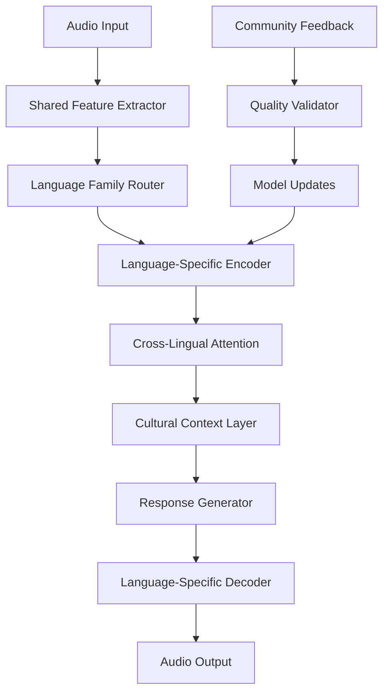

# African Language Moshi: Technical Architecture & Implementation Guide

## Table of Contents
1. [System Overview](#system-overview)
2. [Shared Feature Extractors](#shared-feature-extractors)
3. [Language Family Clustering](#language-family-clustering)
4. [Progressive Training Strategy](#progressive-training-strategy)
5. [Community Integration Framework](#community-integration-framework)
6. [Implementation Details](#implementation-details)
7. [Performance Optimization](#performance-optimization)
8. [Quality Assurance](#quality-assurance)

---

## System Overview

### Architecture Philosophy
The African Language Moshi system is built on four core principles:

1. **Linguistic Universality**: Shared features across African languages
2. **Cultural Preservation**: Maintaining linguistic nuances and cultural context
3. **Progressive Learning**: Building from high-resource to low-resource languages
4. **Community Partnership**: Native speaker validation and continuous improvement

### High-Level Architecture



---

## Shared Feature Extractors

### 1. Cross-Lingual Phonetic Encoder

```python
class CrossLingualPhoneticEncoder(nn.Module):
    """
    Extracts universal phonetic features from African language audio.
    Handles unique African phonemes like clicks, ejectives, and implosives.
    """
    def __init__(self, feature_dim=512):
        super().__init__()
        self.conv_layers = nn.ModuleList([
            # Specialized for African phonetic features
            nn.Conv1d(80, 128, 3, padding=1),  # Basic phonemes
            nn.Conv1d(128, 256, 3, padding=1),  # Click consonants
            nn.Conv1d(256, 512, 3, padding=1),  # Ejectives/implosives
        ])
        self.phoneme_classifier = nn.Linear(512, 200)  # 200 African phonemes
        
    def forward(self, mel_spec):
        """
        Args:
            mel_spec: Mel spectrogram [B, 80, T]
        Returns:
            phonetic_features: [B, 512, T]
            phoneme_probs: [B, 200, T]
        """
        x = mel_spec
        for conv in self.conv_layers:
            x = F.relu(conv(x))
        
        phonetic_features = x
        phoneme_probs = self.phoneme_classifier(x.transpose(1, 2)).transpose(1, 2)
        
        return phonetic_features, phoneme_probs
```

### 2. Tonal Pattern Encoder

```python
class TonalPatternEncoder(nn.Module):
    """
    Critical for African languages: extracts tonal patterns and contours.
    Handles level tones, contour tones, and tonal sandhi.
    """
    def __init__(self, hidden_dim=256):
        super().__init__()
        self.pitch_extractor = PitchExtractor()
        self.tone_classifier = nn.Sequential(
            nn.Linear(1, 64),
            nn.ReLU(),
            nn.Linear(64, 128),
            nn.ReLU(),
            nn.Linear(128, 9)  # 5 level tones + 4 contour tones
        )
        self.tone_context_encoder = nn.LSTM(9, hidden_dim, bidirectional=True)
        
    def forward(self, audio):
        """
        Args:
            audio: Raw audio [B, T]
        Returns:
            tone_features: [B, hidden_dim*2, T']
            tone_classes: [B, 9, T']
        """
        # Extract fundamental frequency
        f0 = self.pitch_extractor(audio)  # [B, T']
        
        # Classify tones
        tone_classes = self.tone_classifier(f0.unsqueeze(-1))  # [B, T', 9]
        
        # Encode tonal context
        tone_features, _ = self.tone_context_encoder(tone_classes)  # [B, T', hidden_dim*2]
        
        return tone_features.transpose(1, 2), tone_classes.transpose(1, 2)
```

### 3. Prosodic Feature Encoder

```python
class ProsodicFeatureEncoder(nn.Module):
    """
    Captures rhythm, stress patterns, and intonation specific to African languages.
    """
    def __init__(self, feature_dim=128):
        super().__init__()
        self.energy_extractor = EnergyExtractor()
        self.rhythm_encoder = RhythmPatternEncoder()
        self.stress_detector = StressPatternDetector()
        
    def forward(self, audio, phonetic_features):
        """
        Args:
            audio: Raw audio [B, T]
            phonetic_features: From phonetic encoder [B, 512, T']
        Returns:
            prosodic_features: [B, feature_dim, T']
        """
        energy = self.energy_extractor(audio)
        rhythm = self.rhythm_encoder(energy, phonetic_features)
        stress = self.stress_detector(energy, phonetic_features)
        
        return torch.cat([rhythm, stress], dim=1)
```

### 4. Universal Acoustic Encoder

```python
class UniversalAcousticEncoder(nn.Module):
    """
    Language-agnostic acoustic feature extraction using self-supervised learning.
    """
    def __init__(self, model_name="wav2vec2-large-african"):
        super().__init__()
        # Pre-trained on diverse African language audio
        self.wav2vec = Wav2Vec2Model.from_pretrained(model_name)
        self.projection = nn.Linear(1024, 512)
        
    def forward(self, audio):
        """
        Args:
            audio: Raw audio [B, T]
        Returns:
            acoustic_features: [B, 512, T']
        """
        with torch.no_grad():
            features = self.wav2vec(audio).last_hidden_state
        return self.projection(features).transpose(1, 2)
```

---

## Language Family Clustering

### African Language Taxonomy

```python
class AfricanLanguageTaxonomy:
    """
    Hierarchical organization of African languages for optimal training.
    """
    LANGUAGE_FAMILIES = {
        'Niger-Congo': {
            'Kwa': {
                'languages': ['twi', 'fante', 'ga', 'ewe'],
                'speakers': 15_000_000,
                'shared_features': ['ATR_vowels', 'serial_verbs', 'noun_classes'],
                'training_tier': 1
            },
            'Yoruboid': {
                'languages': ['yoruba', 'igala'],
                'speakers': 40_000_000,
                'shared_features': ['tone_terracing', 'nasal_vowels'],
                'training_tier': 1
            },
            'Bantu': {
                'languages': ['swahili', 'zulu', 'xhosa', 'shona'],
                'speakers': 100_000_000,
                'shared_features': ['noun_classes', 'agglutination', 'clicks'],
                'training_tier': 1
            }
        },
        'Afroasiatic': {
            'Cushitic': {
                'languages': ['amharic', 'oromo', 'somali'],
                'speakers': 80_000_000,
                'shared_features': ['ejectives', 'pharyngeals', 'root_morphology'],
                'training_tier': 2
            },
            'Chadic': {
                'languages': ['hausa', 'kanuri'],
                'speakers': 50_000_000,
                'shared_features': ['tone', 'consonant_clusters'],
                'training_tier': 2
            }
        }
    }
    
    @classmethod
    def get_training_order(cls):
        """
        Returns optimal training order based on linguistic similarity and data availability.
        """
        families = cls.LANGUAGE_FAMILIES
        training_order = []
        
        # Tier 1: High-resource languages with good data
        tier1_langs = []
        for family in families.values():
            for subfamily in family.values():
                if isinstance(subfamily, dict) and subfamily.get('training_tier') == 1:
                    tier1_langs.extend(subfamily['languages'])
        
        training_order.extend(tier1_langs)
        
        # Tier 2: Medium-resource languages
        # ... similar logic for other tiers
        
        return training_order
```

### Language Similarity Matrix

```python
class LanguageSimilarityMatrix:
    """
    Computes similarity between languages for transfer learning optimization.
    """
    def __init__(self):
        self.phonetic_similarity = self._compute_phonetic_similarity()
        self.tonal_similarity = self._compute_tonal_similarity()
        self.morphological_similarity = self._compute_morphological_similarity()
        
    def _compute_phonetic_similarity(self):
        """
        Based on phoneme inventory overlap and distinctive features.
        """
        # Example: Twi and Fante share 85% of phonemes
        similarity_matrix = {
            ('twi', 'fante'): 0.85,
            ('twi', 'ga'): 0.72,
            ('yoruba', 'igala'): 0.78,
            ('swahili', 'zulu'): 0.65,
            # ... more language pairs
        }
        return similarity_matrix
    
    def get_transfer_candidates(self, target_language):
        """
        Returns best source languages for transfer learning to target.
        """
        candidates = []
        for (lang1, lang2), similarity in self.phonetic_similarity.items():
            if lang2 == target_language:
                candidates.append((lang1, similarity))
            elif lang1 == target_language:
                candidates.append((lang2, similarity))
        
        return sorted(candidates, key=lambda x: x[1], reverse=True)
```

---

## Progressive Training Strategy

### Curriculum Learning Framework

```python
class AfricanLanguageCurriculum:
    """
    Progressive training curriculum optimized for African languages.
    """
    def __init__(self):
        self.training_stages = [
            'phonetic_foundation',
            'tonal_patterns',
            'morphological_structure',
            'syntactic_patterns',
            'cultural_context'
        ]
        
    def get_stage_data(self, stage, language):
        """
        Returns training data appropriate for current learning stage.
        """
        if stage == 'phonetic_foundation':
            return self._get_phonetic_minimal_pairs(language)
        elif stage == 'tonal_patterns':
            return self._get_tonal_word_pairs(language)
        # ... other stages
        
    def _get_phonetic_minimal_pairs(self, language):
        """
        Generate phonetic minimal pairs for foundational learning.
        Example for Twi: ['pa' vs 'ba', 'ka' vs 'ga']
        """
        minimal_pairs = {
            'twi': [
                (['p', 'a'], ['b', 'a'], 'voicing'),
                (['k', 'a'], ['g', 'a'], 'voicing'),
                (['t', 'i'], ['c', 'i'], 'palatalization'),
            ],
            'yoruba': [
                (['k', 'a'], ['g', 'a'], 'voicing'),
                (['o'], ['ɔ'], 'atr'),
                (['e'], ['ɛ'], 'atr'),
            ]
        }
        return minimal_pairs.get(language, [])
```

### Transfer Learning Protocol

```python
class CrossLingualTransferLearning:
    """
    Optimized transfer learning for African language families.
    """
    def __init__(self, source_model, target_language):
        self.source_model = source_model
        self.target_language = target_language
        self.similarity_matrix = LanguageSimilarityMatrix()
        
    def adapt_model(self, target_data, adaptation_strategy='gradual_unfreezing'):
        """
        Adapt source model to target language using optimal strategy.
        """
        if adaptation_strategy == 'gradual_unfreezing':
            return self._gradual_unfreezing(target_data)
        elif adaptation_strategy == 'adapter_layers':
            return self._adapter_layers(target_data)
        elif adaptation_strategy == 'meta_learning':
            return self._meta_learning(target_data)
            
    def _gradual_unfreezing(self, target_data):
        """
        Gradually unfreeze model layers during fine-tuning.
        """
        # Start with frozen encoder, only train decoder
        for param in self.source_model.encoder.parameters():
            param.requires_grad = False
            
        # Train decoder for 1000 steps
        self._train_steps(target_data, steps=1000)
        
        # Unfreeze top encoder layers
        for param in self.source_model.encoder[-2:].parameters():
            param.requires_grad = True
            
        # Continue training
        self._train_steps(target_data, steps=2000)
        
        # Unfreeze all layers
        for param in self.source_model.parameters():
            param.requires_grad = True
            
        # Final training
        self._train_steps(target_data, steps=5000)
```

---

## Community Integration Framework

### Speaker Validation System

```python
class CommunityValidationSystem:
    """
    Integrates native speakers into the quality assurance process.
    """
    def __init__(self, language):
        self.language = language
        self.validator_pool = self._build_validator_pool()
        self.quality_thresholds = {
            'pronunciation': 0.8,
            'naturalness': 0.75,
            'cultural_appropriateness': 0.9
        }
        
    def _build_validator_pool(self):
        """
        Recruit and verify native speakers for validation.
        """
        return {
            'fluent_speakers': [],  # Native/heritage speakers
            'language_teachers': [],  # Educators
            'cultural_experts': [],  # Elders, storytellers
            'linguists': []  # Academic experts
        }
        
    def validate_output(self, audio_sample, text_prompt):
        """
        Submit audio sample for community validation.
        """
        validation_task = {
            'audio': audio_sample,
            'prompt': text_prompt,
            'language': self.language,
            'validation_aspects': [
                'pronunciation_accuracy',
                'tonal_correctness',
                'naturalness',
                'cultural_appropriateness'
            ]
        }
        
        # Distribute to multiple validators
        validators = self._select_validators(validation_task)
        results = []
        
        for validator in validators:
            result = validator.evaluate(validation_task)
            results.append(result)
            
        return self._aggregate_validation_results(results)
        
    def _aggregate_validation_results(self, results):
        """
        Combine multiple validator assessments into final score.
        """
        aggregated = {}
        for aspect in self.quality_thresholds:
            scores = [r[aspect] for r in results if aspect in r]
            # Use median to reduce outlier impact
            aggregated[aspect] = np.median(scores)
            
        return aggregated
```

### Correction Feedback Loop

```python
class CorrectionFeedbackSystem:
    """
    Enables community corrections and model improvement.
    """
    def __init__(self):
        self.correction_database = CorrectionDatabase()
        self.model_updater = IncrementalModelUpdater()
        
    def submit_correction(self, original_audio, corrected_audio, correction_type):
        """
        Allow community members to submit corrections.
        """
        correction = {
            'id': generate_uuid(),
            'original': original_audio,
            'corrected': corrected_audio,
            'type': correction_type,  # 'pronunciation', 'tone', 'cultural'
            'timestamp': datetime.now(),
            'validator_id': self._get_validator_id(),
            'status': 'pending_review'
        }
        
        self.correction_database.store(correction)
        
        # If enough similar corrections, trigger model update
        similar_corrections = self._find_similar_corrections(correction)
        if len(similar_corrections) >= 5:  # Threshold for pattern
            self._trigger_model_update(similar_corrections)
            
    def _trigger_model_update(self, corrections):
        """
        Update model based on consistent correction patterns.
        """
        # Extract training data from corrections
        training_pairs = []
        for correction in corrections:
            training_pairs.append({
                'input': correction['original'],
                'target': correction['corrected'],
                'weight': self._calculate_correction_weight(correction)
            })
            
        # Incremental model update
        self.model_updater.update(training_pairs)
```

### Community Incentive System

```python
class CommunityIncentiveSystem:
    """
    Gamification and incentive system for community engagement.
    """
    def __init__(self):
        self.points_system = {
            'validation_task': 10,
            'correction_submission': 25,
            'quality_improvement': 50,
            'new_language_data': 100
        }
        self.achievement_levels = {
            'Bronze': 100,
            'Silver': 500,
            'Gold': 1000,
            'Platinum': 2500,
            'Diamond': 5000
        }
        
    def award_points(self, user_id, activity, quality_score=1.0):
        """
        Award points based on community contribution.
        """
        base_points = self.points_system.get(activity, 0)
        final_points = int(base_points * quality_score)
        
        # Update user profile
        user_profile = self._get_user_profile(user_id)
        user_profile['total_points'] += final_points
        user_profile['activities'].append({
            'activity': activity,
            'points': final_points,
            'timestamp': datetime.now()
        })
        
        # Check for level progression
        new_level = self._check_level_progression(user_profile)
        if new_level:
            self._award_achievement(user_id, new_level)
            
        return final_points
        
    def generate_leaderboard(self, language=None, timeframe='monthly'):
        """
        Generate community leaderboard to encourage participation.
        """
        filters = {}
        if language:
            filters['language'] = language
        if timeframe == 'monthly':
            filters['timestamp'] = {'$gte': datetime.now() - timedelta(days=30)}
            
        return self.database.get_top_contributors(filters, limit=50)
```

---

## Implementation Details

### Model Architecture

```python
class AfricanLanguageMoshi(nn.Module):
    """
    Complete African Language Moshi implementation.
    """
    def __init__(self, config):
        super().__init__()
        self.config = config
        
        # Shared feature extractors
        self.phonetic_encoder = CrossLingualPhoneticEncoder()
        self.tonal_encoder = TonalPatternEncoder()
        self.prosodic_encoder = ProsodicFeatureEncoder()
        self.acoustic_encoder = UniversalAcousticEncoder()
        
        # Language-specific components
        self.language_router = LanguageFamilyRouter()
        self.language_encoders = nn.ModuleDict({
            lang: LanguageSpecificEncoder(config, lang) 
            for lang in config.supported_languages
        })
        
        # Cross-lingual attention
        self.cross_lingual_attention = CrossLingualAttentionLayer()
        
        # Cultural context integration
        self.cultural_context = CulturalContextLayer()
        
        # Response generation
        self.response_generator = ResponseGenerationLayer()
        
        # Language-specific decoders
        self.language_decoders = nn.ModuleDict({
            lang: LanguageSpecificDecoder(config, lang)
            for lang in config.supported_languages
        })
        
    def forward(self, audio_input, language_id=None):
        """
        Forward pass through African Language Moshi.
        """
        # Extract shared features
        phonetic_features, phoneme_probs = self.phonetic_encoder(audio_input)
        tonal_features, tone_classes = self.tonal_encoder(audio_input)
        prosodic_features = self.prosodic_encoder(audio_input, phonetic_features)
        acoustic_features = self.acoustic_encoder(audio_input)
        
        # Combine all features
        combined_features = torch.cat([
            phonetic_features,
            tonal_features,
            prosodic_features,
            acoustic_features
        ], dim=1)
        
        # Route to appropriate language family if not specified
        if language_id is None:
            language_id = self.language_router(combined_features)
            
        # Language-specific encoding
        encoded_features = self.language_encoders[language_id](combined_features)
        
        # Cross-lingual attention for transfer learning
        attended_features = self.cross_lingual_attention(encoded_features, language_id)
        
        # Add cultural context
        cultural_features = self.cultural_context(attended_features, language_id)
        
        # Generate response
        response_features = self.response_generator(cultural_features)
        
        # Language-specific decoding
        audio_output = self.language_decoders[language_id](response_features)
        
        return audio_output, language_id
```

### Training Loop

```python
class AfricanLanguageTrainer:
    """
    Specialized trainer for African Language Moshi.
    """
    def __init__(self, model, config):
        self.model = model
        self.config = config
        self.curriculum = AfricanLanguageCurriculum()
        self.transfer_learner = CrossLingualTransferLearning()
        self.community_validator = CommunityValidationSystem()
        
    def train_progressive(self, language_order, data_loaders):
        """
        Progressive training across African languages.
        """
        for language in language_order:
            print(f"Training {language}...")
            
            # Get curriculum stages for this language
            stages = self.curriculum.training_stages
            data_loader = data_loaders[language]
            
            for stage in stages:
                print(f"  Stage: {stage}")
                stage_data = self.curriculum.get_stage_data(stage, language)
                
                # Train on stage-specific data
                self._train_stage(stage_data, language, stage)
                
                # Validate with community
                validation_score = self._community_validation(language, stage)
                
                if validation_score < self.config.quality_threshold:
                    print(f"    Quality below threshold: {validation_score}")
                    # Additional training or data collection needed
                    continue
                    
            # Transfer learning preparation for next language
            if language != language_order[-1]:
                self._prepare_transfer_learning(language)
                
    def _train_stage(self, stage_data, language, stage):
        """
        Train model on specific curriculum stage.
        """
        optimizer = torch.optim.AdamW(self.model.parameters(), lr=1e-4)
        
        for epoch in range(self.config.epochs_per_stage):
            for batch in stage_data:
                optimizer.zero_grad()
                
                # Forward pass
                output, predicted_lang = self.model(
                    batch['audio'], 
                    language_id=language
                )
                
                # Compute loss based on stage
                if stage == 'phonetic_foundation':
                    loss = self._phonetic_loss(output, batch)
                elif stage == 'tonal_patterns':
                    loss = self._tonal_loss(output, batch)
                # ... other stage-specific losses
                
                loss.backward()
                optimizer.step()
```

---

## Performance Optimization

### Efficient Inference

```python
class OptimizedInference:
    """
    Optimizations for real-time African language processing.
    """
    def __init__(self, model):
        self.model = model
        self.cache = FeatureCache()
        self.quantized_model = self._quantize_model()
        
    def _quantize_model(self):
        """
        Quantize model for mobile/edge deployment.
        """
        # Dynamic quantization for inference
        quantized = torch.quantization.quantize_dynamic(
            self.model, 
            {nn.Linear, nn.LSTM, nn.GRU}, 
            dtype=torch.qint8
        )
        return quantized
        
    def streaming_inference(self, audio_stream, language_id):
        """
        Process audio stream in real-time with minimal latency.
        """
        buffer = AudioBuffer(sample_rate=16000, duration=0.5)  # 500ms buffer
        
        for audio_chunk in audio_stream:
            buffer.add(audio_chunk)
            
            if buffer.is_full():
                # Extract features from buffer
                features = self._extract_features_fast(buffer.data)
                
                # Use cached features for efficiency
                if self.cache.has_similar(features):
                    cached_result = self.cache.get_similar(features)
                    yield self._adapt_cached_result(cached_result, features)
                else:
                    # Full inference
                    result = self.quantized_model(buffer.data, language_id)
                    self.cache.store(features, result)
                    yield result
                    
                buffer.clear()
```

### Memory Optimization

```python
class MemoryOptimizer:
    """
    Optimize memory usage for large multilingual models.
    """
    def __init__(self, model):
        self.model = model
        self.active_languages = set()
        self.language_modules = {}
        
    def activate_language(self, language_id):
        """
        Load only necessary language-specific modules.
        """
        if language_id not in self.active_languages:
            # Load language-specific encoder/decoder
            encoder_path = f"models/encoders/{language_id}.pt"
            decoder_path = f"models/decoders/{language_id}.pt"
            
            encoder = torch.load(encoder_path, map_location='cpu')
            decoder = torch.load(decoder_path, map_location='cpu')
            
            self.language_modules[language_id] = {
                'encoder': encoder,
                'decoder': decoder
            }
            self.active_languages.add(language_id)
            
    def deactivate_language(self, language_id):
        """
        Unload unused language modules to free memory.
        """
        if language_id in self.active_languages:
            del self.language_modules[language_id]
            self.active_languages.remove(language_id)
            torch.cuda.empty_cache()  # Clear GPU memory
```

---

## Quality Assurance

### Automated Testing Framework

```python
class AfricanLanguageTestSuite:
    """
    Comprehensive testing for African language capabilities.
    """
    def __init__(self):
        self.test_cases = self._load_test_cases()
        self.metrics = QualityMetrics()
        
    def _load_test_cases(self):
        """
        Load language-specific test cases covering:
        - Phonetic accuracy
        - Tonal correctness
        - Cultural appropriateness
        - Grammatical structure
        """
        return {
            'phonetic_tests': self._load_phonetic_tests(),
            'tonal_tests': self._load_tonal_tests(),
            'cultural_tests': self._load_cultural_tests(),
            'grammatical_tests': self._load_grammatical_tests()
        }
        
    def run_comprehensive_evaluation(self, model, language):
        """
        Run full evaluation suite for a specific language.
        """
        results = {
            'language': language,
            'timestamp': datetime.now(),
            'scores': {}
        }
        
        # Phonetic accuracy tests
        phonetic_score = self._evaluate_phonetic_accuracy(
            model, 
            self.test_cases['phonetic_tests'][language]
        )
        results['scores']['phonetic_accuracy'] = phonetic_score
        
        # Tonal correctness tests
        tonal_score = self._evaluate_tonal_correctness(
            model,
            self.test_cases['tonal_tests'][language]
        )
        results['scores']['tonal_correctness'] = tonal_score
        
        # Cultural appropriateness tests
        cultural_score = self._evaluate_cultural_appropriateness(
            model,
            self.test_cases['cultural_tests'][language]
        )
        results['scores']['cultural_appropriateness'] = cultural_score
        
        # Overall quality score
        results['overall_score'] = self._calculate_overall_score(results['scores'])
        
        return results
        
    def _evaluate_phonetic_accuracy(self, model, test_cases):
        """
        Evaluate phonetic accuracy using minimal pairs and IPA transcription.
        """
        correct_predictions = 0
        total_predictions = 0
        
        for test_case in test_cases:
            # Generate audio for minimal pair
            audio1 = model.generate(test_case['word1'])
            audio2 = model.generate(test_case['word2'])
            
            # Extract phonetic features
            features1 = extract_phonetic_features(audio1)
            features2 = extract_phonetic_features(audio2)
            
            # Check if distinctive feature is correctly realized
            distinctive_feature = test_case['distinctive_feature']
            if self._check_distinctive_feature(features1, features2, distinctive_feature):
                correct_predictions += 1
            total_predictions += 1
            
        return correct_predictions / total_predictions if total_predictions > 0 else 0.0
```

### Bias Detection and Mitigation

```python
class BiasDetectionSystem:
    """
    Detect and mitigate bias in African language models.
    """
    def __init__(self):
        self.bias_categories = [
            'gender_bias',
            'age_bias',
            'regional_bias',
            'socioeconomic_bias',
            'ethnic_bias'
        ]
        
    def detect_bias(self, model, test_data):
        """
        Comprehensive bias detection across multiple dimensions.
        """
        bias_scores = {}
        
        for category in self.bias_categories:
            score = self._evaluate_bias_category(model, test_data, category)
            bias_scores[category] = score
            
        return bias_scores
        
    def _evaluate_bias_category(self, model, test_data, category):
        """
        Evaluate bias for a specific category.
        """
        if category == 'gender_bias':
            return self._evaluate_gender_bias(model, test_data)
        elif category == 'regional_bias':
            return self._evaluate_regional_bias(model, test_data)
        # ... other bias categories
        
    def _evaluate_gender_bias(self, model, test_data):
        """
        Check for gender bias in voice synthesis and understanding.
        """
        male_prompts = test_data['gender']['male']
        female_prompts = test_data['gender']['female']
        
        male_quality_scores = []
        female_quality_scores = []
        
        for prompt in male_prompts:
            audio = model.generate(prompt)
            quality = self._assess_audio_quality(audio)
            male_quality_scores.append(quality)
            
        for prompt in female_prompts:
            audio = model.generate(prompt)
            quality = self._assess_audio_quality(audio)
            female_quality_scores.append(quality)
            
        # Bias score: difference in mean quality scores
        male_mean = np.mean(male_quality_scores)
        female_mean = np.mean(female_quality_scores)
        
        return abs(male_mean - female_mean)
```

---

## Conclusion

This architecture provides a comprehensive framework for building world-class audio-to-audio conversational AI for African languages. By leveraging shared linguistic features, progressive training strategies, and deep community integration, we can create culturally appropriate and technically excellent voice interfaces that preserve and celebrate African linguistic diversity.

The system's modular design allows for continuous improvement and expansion to additional languages, while the community feedback loops ensure that the technology remains grounded in authentic linguistic and cultural knowledge.

**Next Steps:**
1. Implement Phase 1 foundation components
2. Begin data collection for Tier 1 languages
3. Establish community partnerships
4. Start baseline model training
5. Deploy initial validation systems