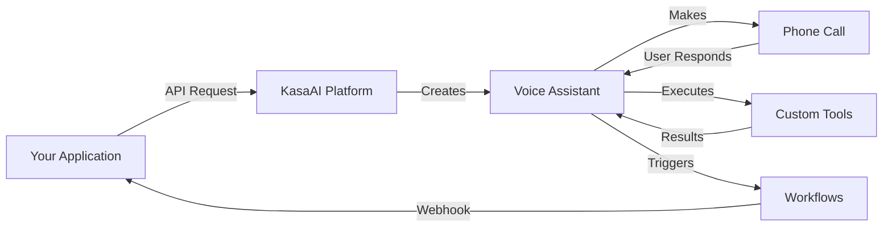

# Welcome to KasaAI

KasaAI is a comprehensive platform for building voice AI assistants and automating communication workflows. Whether you're building a customer support bot, appointment reminder system, or complex voice automation workflow, KasaAI has you covered.

## 🚀 What You Can Build

### 📞 Voice Assistants
Create intelligent voice assistants that can handle phone calls, understand natural language, and take actions using custom tools and integrations.

### 🔄 Automation Workflows
Build complex automation workflows using visual workflow builders (n8n) or custom webhooks. Connect to hundreds of services and APIs.

### 📊 Analytics & Insights
Track usage, monitor performance, and gain insights into your voice AI interactions with comprehensive analytics.

## ✨ Key Features

- **🎙️ Natural Voice Conversations** - Powered by state-of-the-art AI models
- **🛠️ Custom Tools & Functions** - Extend assistants with custom capabilities
- **🔗 Webhook Integration** - Connect to any external service
- **📱 Phone Number Management** - Buy and manage phone numbers
- **🎯 Smart Call Routing** - Transfer calls intelligently
- **📈 Real-time Analytics** - Monitor usage and performance
- **🔐 Enterprise Security** - Bank-grade encryption and compliance
- **⚡ High Availability** - 99.9% uptime SLA

## 🎯 Quick Overview

Here's how KasaAI works:

1. **Create an Assistant** - Define your assistant's personality, voice, and capabilities
2. **Add Tools** - Give your assistant access to custom functions and APIs
3. **Make Calls** - Trigger calls programmatically or receive inbound calls
4. **Handle Events** - Receive webhooks for call events and take actions
5. **Analyze Results** - Review call transcripts, analytics, and performance

## 🏗️ Architecture

KasaAI is built on three core pillars:

### Voice Layer
State-of-the-art speech recognition and synthesis powered by leading AI models. Natural, human-like conversations with low latency.

### Logic Layer
Flexible assistant configuration with custom tools, function calling, and intelligent decision-making. Your assistants can interact with any API.

### Integration Layer
Connect to n8n workflows, webhooks, or any external service. Build complex automation without writing code.

## 🎓 Learning Path

**Beginner**
- [Quickstart Guide](/getting-started/quickstart)
- [Authentication](/getting-started/authentication)
- [Your First API Call](/getting-started/first-api-call)

**Intermediate**
- [Creating Voice Assistants](/guides/voice-assistants/creating-assistants)
- [Making Phone Calls](/guides/phone-calls/making-calls)
- [Building Workflows](/guides/workflows/creating-workflows)

**Advanced**
- [Custom Tools & Functions](/guides/voice-assistants/adding-tools)
- [Webhook Handlers](/guides/workflows/webhook-handlers)
- [Production Best Practices](/guides/best-practices/production-checklist)

## 💡 Use Cases

KasaAI powers voice automation across industries:

- **Customer Support** - 24/7 AI support agents
- **Healthcare** - Appointment reminders and follow-ups
- **E-commerce** - Order status and delivery notifications
- **Finance** - Payment reminders and account alerts
- **Real Estate** - Lead qualification and property inquiries
- **Education** - Student notifications and parent communication

[Explore all use cases →](/use-cases/customer-support-bot)

## 🌍 Global Coverage

- **25+ Languages** - Support for major world languages
- **50+ Countries** - Phone numbers available globally
- **99.9% Uptime** - Enterprise-grade reliability
- **< 500ms Latency** - Fast, natural conversations

## 🔐 Security & Compliance

KasaAI is built with security at its core:

- **SOC 2 Type II Certified**
- **GDPR Compliant**
- **HIPAA Ready**
- **End-to-End Encryption**
- **Regular Security Audits**

## 🤝 Support

We're here to help you succeed:

- **📚 Documentation** - Comprehensive guides and tutorials
- **💬 Discord Community** - Chat with other developers
- **📧 Email Support** - Get help from our team
- **🎯 Dedicated Support** - Available for enterprise customers

## Ready to Get Started?

  <a href="/getting-started/quickstart" class="button button--primary button--lg">
    Start Building →
  </a>
  <a href="/api-reference/overview" class="button button--secondary button--lg">
    View API Docs
  </a>

---

**Questions?** Join our [Discord community](https://discord.gg/kasaai) or [contact support](https://support.ailabsafrica.com).
