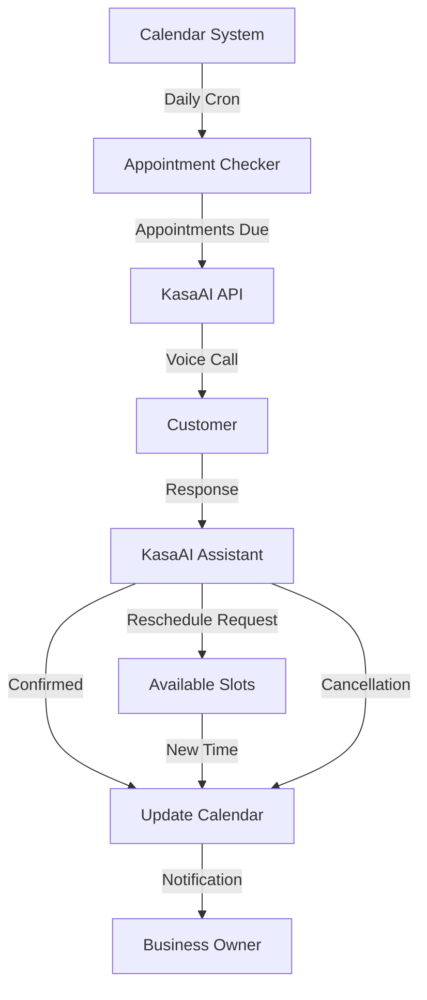

# Appointment Reminders

Build an intelligent appointment reminder system that automatically calls customers to confirm appointments, reschedule if needed, and update your calendar system.

## Overview

This use case demonstrates how to:
- ✅ Automatically call customers 24 hours before appointments
- ✅ Confirm or reschedule appointments via voice
- ✅ Update calendar systems in real-time
- ✅ Handle multiple appointment types (medical, salon, restaurant, etc.)
- ✅ Reduce no-shows by up to 60%

## Architecture



## Benefits

- 📉 **Reduce No-Shows** - Cut no-show rates by 50-60%
- ⏰ **Save Time** - Eliminate manual reminder calls
- 💰 **Increase Revenue** - Fill cancelled slots automatically
- 😊 **Better Experience** - Convenient for customers
- 📊 **Track Metrics** - Monitor confirmation rates

## Implementation

### Step 1: Create Reminder Assistant

```python
import requests
from datetime import datetime, timedelta

API_KEY = "your_api_key"
BASE_URL = "https://developer.ailabsafrica.com/api/v1"

def create_reminder_assistant():
    """Create assistant for appointment reminders."""

    response = requests.post(
        f"{BASE_URL}/assistants",
        headers={"X-API-Key": API_KEY},
        json={
            "name": "Appointment Reminder Assistant",
            "voice": {
                "provider": "elevenlabs",
                "voice_id": "21m00Tcm4TlvDq8ikWAM",
                "stability": 0.7,
                "similarity_boost": 0.8
            },
            "model": {
                "provider": "openai",
                "model": "gpt-4",
                "temperature": 0.7,
                "max_tokens": 300
            },
            "first_message": (
                "Hello! This is {business_name} calling to confirm your "
                "{appointment_type} appointment scheduled for {appointment_time}. "
                "Can you confirm that you'll be able to make it?"
            ),
            "system_prompt": (
                "You are a friendly appointment reminder assistant for {business_name}. "
                "Your goal is to confirm the appointment. If the customer needs to "
                "reschedule or cancel, be understanding and offer to help. "
                "Be concise and respectful of their time. "
                "Always confirm the final decision before ending the call."
            ),
            "tools": [
                {
                    "type": "function",
                    "function": {
                        "name": "confirm_appointment",
                        "description": "Confirm the appointment",
                        "parameters": {
                            "type": "object",
                            "properties": {
                                "appointment_id": {"type": "string"},
                                "confirmed": {"type": "boolean"}
                            },
                            "required": ["appointment_id", "confirmed"]
                        }
                    }
                },
                {
                    "type": "function",
                    "function": {
                        "name": "get_available_slots",
                        "description": "Get available time slots for rescheduling",
                        "parameters": {
                            "type": "object",
                            "properties": {
                                "date": {"type": "string", "description": "Preferred date"},
                                "service_duration": {"type": "integer"}
                            },
                            "required": ["date"]
                        }
                    }
                },
                {
                    "type": "function",
                    "function": {
                        "name": "reschedule_appointment",
                        "description": "Reschedule the appointment to a new time",
                        "parameters": {
                            "type": "object",
                            "properties": {
                                "appointment_id": {"type": "string"},
                                "new_datetime": {"type": "string"}
                            },
                            "required": ["appointment_id", "new_datetime"]
                        }
                    }
                },
                {
                    "type": "function",
                    "function": {
                        "name": "cancel_appointment",
                        "description": "Cancel the appointment",
                        "parameters": {
                            "type": "object",
                            "properties": {
                                "appointment_id": {"type": "string"},
                                "reason": {"type": "string"}
                            },
                            "required": ["appointment_id"]
                        }
                    }
                }
            ],
            "webhook_url": "https://your-app.com/webhooks/kasaai"
        }
    )

    return response.json()
```

### Step 2: Schedule Daily Reminder Job

```python
from apscheduler.schedulers.background import BackgroundScheduler
from datetime import datetime, timedelta

def get_appointments_for_tomorrow():
    """Get appointments scheduled for tomorrow."""
    tomorrow = datetime.now() + timedelta(days=1)

    # Query your database
    appointments = db.appointments.find({
        "date": {
            "$gte": tomorrow.replace(hour=0, minute=0),
            "$lt": tomorrow.replace(hour=23, minute=59)
        },
        "status": "scheduled",
        "reminder_sent": False
    })

    return list(appointments)


def send_appointment_reminders():
    """Send reminders for tomorrow's appointments."""
    appointments = get_appointments_for_tomorrow()

    print(f"Sending reminders for {len(appointments)} appointments")

    for appointment in appointments:
        # Make call to customer
        response = requests.post(
            f"{BASE_URL}/calls",
            headers={"X-API-Key": API_KEY},
            json={
                "assistant_id": "asst_reminder_123",
                "phone_number": appointment["customer_phone"],
                "max_duration_minutes": 5,
                "metadata": {
                    "appointment_id": str(appointment["_id"]),
                    "customer_name": appointment["customer_name"],
                    "appointment_time": appointment["datetime"].isoformat(),
                    "appointment_type": appointment["service_type"],
                    "business_name": "Acme Clinic"
                }
            }
        )

        # Update reminder status
        db.appointments.update_one(
            {"_id": appointment["_id"]},
            {"$set": {"reminder_sent": True, "reminder_call_id": response.json()["id"]}}
        )

        print(f"✓ Reminder sent to {appointment['customer_name']}")


# Schedule job to run daily at 9 AM
scheduler = BackgroundScheduler()
scheduler.add_job(
    send_appointment_reminders,
    'cron',
    hour=9,
    minute=0
)
scheduler.start()
```

### Step 3: Handle Assistant Actions

```python
from fastapi import FastAPI, Request
import httpx

app = FastAPI()

@app.post("/webhooks/kasaai")
async def handle_appointment_actions(request: Request):
    """Handle actions from the appointment reminder assistant."""
    data = await request.json()

    tool_name = data["tool_call"]["function"]["name"]
    arguments = data["tool_call"]["function"]["arguments"]
    metadata = data.get("metadata", {})
    appointment_id = metadata.get("appointment_id")

    if tool_name == "confirm_appointment":
        # Mark appointment as confirmed
        db.appointments.update_one(
            {"_id": appointment_id},
            {"$set": {
                "status": "confirmed",
                "confirmed_at": datetime.utcnow()
            }}
        )

        # Send confirmation to business
        await send_notification(
            appointment_id,
            "Appointment confirmed by customer"
        )

        return {
            "result": "Thank you! Your appointment is confirmed. We'll see you tomorrow!"
        }

    elif tool_name == "get_available_slots":
        # Get available time slots from calendar
        date = arguments["date"]
        slots = await get_calendar_availability(date)

        # Format slots for voice response
        slot_text = ", ".join([f"{s['time']}" for s in slots[:3]])

        return {
            "result": f"I have these times available: {slot_text}. Which works best for you?"
        }

    elif tool_name == "reschedule_appointment":
        # Reschedule appointment
        new_datetime = arguments["new_datetime"]

        db.appointments.update_one(
            {"_id": appointment_id},
            {"$set": {
                "datetime": datetime.fromisoformat(new_datetime),
                "status": "rescheduled"
            }}
        )

        await send_notification(
            appointment_id,
            f"Appointment rescheduled to {new_datetime}"
        )

        return {
            "result": f"Perfect! I've rescheduled your appointment to {new_datetime}. You'll receive a confirmation email shortly."
        }

    elif tool_name == "cancel_appointment":
        # Cancel appointment
        reason = arguments.get("reason", "No reason provided")

        db.appointments.update_one(
            {"_id": appointment_id},
            {"$set": {
                "status": "cancelled",
                "cancellation_reason": reason,
                "cancelled_at": datetime.utcnow()
            }}
        )

        # Try to fill the slot
        await notify_waitlist(appointment_id)

        await send_notification(
            appointment_id,
            f"Appointment cancelled: {reason}"
        )

        return {
            "result": "I've cancelled your appointment. We hope to see you again soon!"
        }

    return {"error": "Unknown action"}


async def get_calendar_availability(date: str):
    """Get available slots from calendar system."""
    # Integrate with Google Calendar, Calendly, etc.
    async with httpx.AsyncClient() as client:
        response = await client.get(
            f"https://your-calendar-api.com/availability?date={date}"
        )
        return response.json()["slots"]


async def send_notification(appointment_id: str, message: str):
    """Send notification to business owner."""
    # Send email, SMS, or push notification
    await send_email(
        to="owner@business.com",
        subject=f"Appointment Update: {appointment_id}",
        body=message
    )
```

### Step 4: Track Confirmation Rates

```python
def get_reminder_metrics(days=30):
    """Get metrics on reminder effectiveness."""
    start_date = datetime.now() - timedelta(days=days)

    pipeline = [
        {"$match": {
            "reminder_sent": True,
            "reminder_sent_at": {"$gte": start_date}
        }},
        {"$group": {
            "_id": "$status",
            "count": {"$sum": 1}
        }}
    ]

    results = db.appointments.aggregate(pipeline)
    stats = {item["_id"]: item["count"] for item in results}

    total = sum(stats.values())
    confirmed = stats.get("confirmed", 0)
    rescheduled = stats.get("rescheduled", 0)
    cancelled = stats.get("cancelled", 0)
    no_show = stats.get("no_show", 0)

    return {
        "total_reminders": total,
        "confirmed": confirmed,
        "rescheduled": rescheduled,
        "cancelled": cancelled,
        "no_show": no_show,
        "confirmation_rate": (confirmed / total * 100) if total > 0 else 0,
        "attendance_rate": ((confirmed + rescheduled) / total * 100) if total > 0 else 0
    }


# Generate weekly report
metrics = get_reminder_metrics(7)
print(f"Confirmation Rate: {metrics['confirmation_rate']:.1f}%")
print(f"Attendance Rate: {metrics['attendance_rate']:.1f}%")
print(f"No-Shows Prevented: {metrics['total_reminders'] - metrics['no_show']}")
```

## Best Practices

### 1. Timing is Critical

```python
# Call 24 hours before - not too early, not too late
reminder_time = appointment_datetime - timedelta(hours=24)

# For early morning appointments, call day before evening
if appointment_datetime.hour < 10:
    reminder_time = (appointment_datetime - timedelta(days=1)).replace(hour=18)
```

### 2. Personalize Messages

```python
# Use customer name and service details
first_message = (
    f"Hello {customer_name}! This is {business_name} calling to confirm "
    f"your {service_type} appointment with {provider_name} "
    f"tomorrow at {appointment_time}."
)
```

### 3. Make Rescheduling Easy

```python
# Offer immediate alternatives
if customer_cant_make_it:
    # Get next 3 available slots
    slots = get_next_available_slots(service_duration=appointment_duration, count=3)
    offer_alternatives(slots)
```

### 4. Handle Voicemail Gracefully

```python
# Detect voicemail and leave clear message
if call_status == "voicemail":
    message = (
        f"Hi {customer_name}, this is {business_name}. "
        f"We're confirming your appointment tomorrow at {time}. "
        f"Please call us back at {business_phone} if you need to reschedule. "
        f"Otherwise, we'll see you tomorrow!"
    )
```

### 5. Follow Up Unconfirmed Appointments

```python
# Send SMS if call not answered
if call_result == "no_answer" and not customer_confirmed:
    send_sms(
        customer_phone,
        f"Hi {customer_name}! Reminder: You have an appointment tomorrow "
        f"at {time}. Reply YES to confirm or call us to reschedule."
    )
```

## Advanced Features

### Multi-Language Support

```python
def create_multilingual_assistant(language="en"):
    """Create assistant with language support."""

    messages = {
        "en": "Hello! This is {business_name} calling to confirm your appointment.",
        "es": "¡Hola! Llamamos de {business_name} para confirmar su cita.",
        "fr": "Bonjour! Nous appelons de {business_name} pour confirmer votre rendez-vous."
    }

    return create_assistant(
        first_message=messages[language],
        language=language
    )
```

### Waitlist Management

```python
async def notify_waitlist(cancelled_appointment_id):
    """Notify waitlist when slot becomes available."""
    cancelled_appt = db.appointments.find_one({"_id": cancelled_appointment_id})

    # Find waitlist customers
    waitlist = db.waitlist.find({
        "service_type": cancelled_appt["service_type"],
        "preferred_date": cancelled_appt["date"],
        "notified": False
    }).sort("created_at", 1).limit(3)

    for customer in waitlist:
        # Call first person on waitlist
        response = requests.post(
            f"{BASE_URL}/calls",
            headers={"X-API-Key": API_KEY},
            json={
                "assistant_id": "asst_waitlist_123",
                "phone_number": customer["phone"],
                "metadata": {
                    "available_slot": cancelled_appt["datetime"].isoformat(),
                    "customer_id": str(customer["_id"])
                }
            }
        )

        if response.status_code == 201:
            db.waitlist.update_one(
                {"_id": customer["_id"]},
                {"$set": {"notified": True}}
            )
            break  # Stop after first successful call
```

### Integration with Popular Platforms

```python
# Google Calendar
from google.oauth2.credentials import Credentials
from googleapiclient.discovery import build

def get_appointments_from_google_calendar():
    """Fetch appointments from Google Calendar."""
    creds = Credentials.from_authorized_user_file('token.json')
    service = build('calendar', 'v3', credentials=creds)

    # Get tomorrow's events
    tomorrow_start = (datetime.now() + timedelta(days=1)).replace(hour=0, minute=0)
    tomorrow_end = tomorrow_start.replace(hour=23, minute=59)

    events = service.events().list(
        calendarId='primary',
        timeMin=tomorrow_start.isoformat() + 'Z',
        timeMax=tomorrow_end.isoformat() + 'Z',
        singleEvents=True,
        orderBy='startTime'
    ).execute()

    return events.get('items', [])


# Calendly
import httpx

async def get_appointments_from_calendly():
    """Fetch appointments from Calendly."""
    async with httpx.AsyncClient() as client:
        response = await client.get(
            "https://api.calendly.com/scheduled_events",
            headers={"Authorization": f"Bearer {CALENDLY_TOKEN}"},
            params={
                "min_start_time": (datetime.now() + timedelta(days=1)).isoformat(),
                "max_start_time": (datetime.now() + timedelta(days=2)).isoformat()
            }
        )
        return response.json()["collection"]
```

## Metrics to Track

Monitor these KPIs to measure success:

- **Confirmation Rate** - % of customers who confirm
- **No-Show Rate** - % of unconfirmed appointments that result in no-shows
- **Reschedule Rate** - % of appointments rescheduled
- **Call Answer Rate** - % of calls answered vs. voicemail
- **Time Saved** - Hours saved from manual calling
- **Revenue Recovered** - Value of filled cancelled slots

## Sample Conversation

```text
Assistant: Hello! This is Acme Dental calling to confirm your teeth cleaning appointment tomorrow at 2 PM with Dr. Smith. Can you confirm that you'll be able to make it?

Customer: Oh, actually I need to reschedule. Can we do Thursday instead?