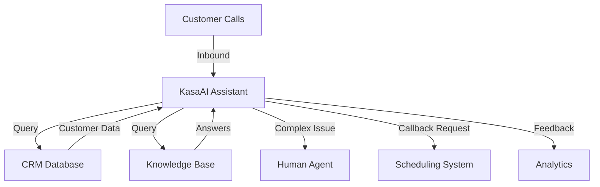

# Customer Support Bot

Build an intelligent customer support system that handles common inquiries, routes complex issues to human agents, and provides 24/7 support.

## Overview

This use case demonstrates how to build a customer support bot that can:
- ✅ Answer frequently asked questions
- ✅ Look up order status and account information
- ✅ Schedule callbacks
- ✅ Escalate to human agents when needed
- ✅ Collect customer feedback

## Architecture



## Implementation

### Step 1: Create the Assistant

First, create an assistant with a customer service personality:

```bash
curl -X POST https://developer.ailabsafrica.com/api/v1/assistants \
  -H "X-API-Key: your_api_key_here" \
  -H "Content-Type: application/json" \
  -d '{
    "name": "Customer Support Agent",
    "voice": {
      "provider": "elevenlabs",
      "voice_id": "21m00Tcm4TlvDq8ikWAM",
      "stability": 0.6,
      "similarity_boost": 0.8
    },
    "model": {
      "provider": "openai",
      "model": "gpt-4",
      "temperature": 0.7,
      "max_tokens": 500
    },
    "first_message": "Thank you for calling Acme Support! I'\''m your AI assistant. May I have your customer ID or phone number to help you today?",
    "system_prompt": "You are a professional customer support agent for Acme Corp. Be empathetic, patient, and helpful. If you cannot resolve an issue, offer to connect the customer with a human agent or schedule a callback. Always confirm information before taking actions.",
    "language": "en-US",
    "tools": [
      {
        "type": "function",
        "function": {
          "name": "lookup_customer",
          "description": "Look up customer information by phone number or customer ID",
          "parameters": {
            "type": "object",
            "properties": {
              "identifier": {
                "type": "string",
                "description": "Customer ID or phone number"
              }
            },
            "required": ["identifier"]
          }
        }
      },
      {
        "type": "function",
        "function": {
          "name": "check_order_status",
          "description": "Check the status of an order",
          "parameters": {
            "type": "object",
            "properties": {
              "order_id": {
                "type": "string",
                "description": "The order ID to check"
              }
            },
            "required": ["order_id"]
          }
        }
      },
      {
        "type": "function",
        "function": {
          "name": "schedule_callback",
          "description": "Schedule a callback from a human agent",
          "parameters": {
            "type": "object",
            "properties": {
              "phone_number": {
                "type": "string",
                "description": "Phone number for callback"
              },
              "preferred_time": {
                "type": "string",
                "description": "Preferred callback time"
              },
              "reason": {
                "type": "string",
                "description": "Reason for callback"
              }
            },
            "required": ["phone_number", "reason"]
          }
        }
      },
      {
        "type": "function",
        "function": {
          "name": "transfer_to_agent",
          "description": "Transfer call to a human agent",
          "parameters": {
            "type": "object",
            "properties": {
              "reason": {
                "type": "string",
                "description": "Reason for transfer"
              }
            },
            "required": ["reason"]
          }
        }
      }
    ],
    "webhook_url": "https://your-app.com/webhooks/kasaai"
  }'
```

### Step 2: Implement Tool Handlers

Create webhook handlers for the custom tools:

```python
from fastapi import FastAPI, Request
import httpx

app = FastAPI()

@app.post("/webhooks/kasaai")
async def handle_tool_call(request: Request):
    """Handle tool calls from KasaAI assistant"""
    data = await request.json()

    tool_name = data["tool_call"]["function"]["name"]
    arguments = data["tool_call"]["function"]["arguments"]

    # Route to appropriate handler
    if tool_name == "lookup_customer":
        result = await lookup_customer(arguments["identifier"])
    elif tool_name == "check_order_status":
        result = await check_order_status(arguments["order_id"])
    elif tool_name == "schedule_callback":
        result = await schedule_callback(arguments)
    elif tool_name == "transfer_to_agent":
        result = await transfer_to_agent(arguments["reason"])
    else:
        result = {"error": "Unknown tool"}

    return {"result": result}

async def lookup_customer(identifier: str):
    """Look up customer in CRM"""
    # Query your CRM database
    async with httpx.AsyncClient() as client:
        response = await client.get(
            f"https://your-crm.com/api/customers/{identifier}"
        )
        customer = response.json()

    return {
        "name": customer["name"],
        "tier": customer["tier"],
        "account_status": customer["status"],
        "outstanding_issues": customer["open_tickets"]
    }

async def check_order_status(order_id: str):
    """Check order status"""
    async with httpx.AsyncClient() as client:
        response = await client.get(
            f"https://your-erp.com/api/orders/{order_id}"
        )
        order = response.json()

    return {
        "order_id": order["id"],
        "status": order["status"],
        "tracking_number": order.get("tracking"),
        "estimated_delivery": order.get("eta")
    }

async def schedule_callback(data: dict):
    """Schedule callback in calendar system"""
    async with httpx.AsyncClient() as client:
        response = await client.post(
            "https://your-calendar.com/api/callbacks",
            json={
                "phone": data["phone_number"],
                "time": data.get("preferred_time"),
                "reason": data["reason"],
                "priority": "high"
            }
        )

    return {
        "scheduled": True,
        "callback_id": response.json()["id"],
        "message": f"Callback scheduled for {data.get('preferred_time', 'next available time')}"
    }

async def transfer_to_agent(reason: str):
    """Transfer to human agent"""
    # This triggers call transfer in KasaAI
    return {
        "transfer": True,
        "destination": "+1234567890",  # Agent phone number
        "message": f"Transferring to agent. Reason: {reason}"
    }
```

### Step 3: Handle Inbound Calls

Set up inbound call handling for customers calling your support line:

```python
@app.post("/webhooks/inbound-call")
async def handle_inbound_call(request: Request):
    """Handle inbound support calls"""
    data = await request.json()

    caller_number = data["from"]

    # Route to support assistant
    async with httpx.AsyncClient() as client:
        response = await client.post(
            "https://developer.ailabsafrica.com/api/v1/calls",
            headers={"X-API-Key": "your_api_key"},
            json={
                "assistant_id": "asst_support_123",
                "phone_number": caller_number,
                "metadata": {
                    "type": "inbound_support",
                    "timestamp": data["timestamp"]
                }
            }
        )

    return response.json()
```

### Step 4: Monitor and Analyze

Track call performance and customer satisfaction:

```python
@app.post("/webhooks/call-completed")
async def handle_call_completed(request: Request):
    """Handle call completion events"""
    data = await request.json()

    call_id = data["call_id"]
    duration = data["duration_seconds"]
    transcript = data["transcript"]

    # Analyze call
    satisfaction = await analyze_sentiment(transcript)
    resolved = await check_resolution(transcript)

    # Store analytics
    await store_analytics({
        "call_id": call_id,
        "duration": duration,
        "satisfaction": satisfaction,
        "resolved": resolved,
        "timestamp": data["ended_at"]
    })

    # Send follow-up if needed
    if satisfaction < 0.5:
        await send_followup_email(data["phone_number"])

    return {"status": "processed"}
```

## Features

### Intelligent Routing

```python
def route_call(customer_data: dict) -> str:
    """Route calls based on customer tier and issue"""
    if customer_data["tier"] == "enterprise":
        return "asst_premium_support"
    elif customer_data["open_tickets"] > 3:
        return "asst_escalation_support"
    else:
        return "asst_general_support"
```

### Business Hours Handling

```python
from datetime import datetime, time

def get_assistant_id() -> str:
    """Return different assistant based on business hours"""
    now = datetime.now().time()

    if time(9, 0) <= now <= time(17, 0):
        # Business hours - full support
        return "asst_business_hours"
    else:
        # After hours - limited support
        return "asst_after_hours"
```

### Multilingual Support

```python
def create_multilingual_assistant(language: str):
    """Create assistant for specific language"""
    prompts = {
        "en": "You are a customer support agent...",
        "es": "Eres un agente de soporte al cliente...",
        "fr": "Vous êtes un agent de support client..."
    }

    return {
        "system_prompt": prompts[language],
        "language": language,
        "first_message": get_greeting(language)
    }
```

## Best Practices

### 1. Set Clear Expectations

```text
first_message: "Thank you for calling! I'm an AI assistant who can help with order status, account questions, and general inquiries. For complex issues, I can connect you with a human agent. How can I help you today?"
```

### 2. Always Offer Human Escalation

```python
if issue_complexity > threshold:
    offer_transfer_to_human()
```

### 3. Confirm Before Taking Action

```text
"Just to confirm, you'd like me to cancel order #12345. Is that correct?"
```

### 4. Collect Feedback

```python
# At end of successful call
ask_satisfaction_rating()
offer_optional_survey()
```

### 5. Handle Errors Gracefully

```python
try:
    result = await lookup_customer(identifier)
except Exception:
    return "I'm having trouble accessing that information. Let me connect you with an agent who can help."
```

## Metrics to Track

Monitor these KPIs:
- **First Call Resolution Rate** - % of issues resolved without escalation
- **Average Handle Time** - Average call duration
- **Customer Satisfaction** - Post-call ratings
- **Containment Rate** - % of calls handled by AI vs. transferred
- **Cost Savings** - Reduction in human agent load

## Advanced Features

### Intent Recognition

```python
def classify_intent(transcript: str) -> str:
    """Classify customer intent"""
    intents = {
        "order_status": ["where is my order", "track", "delivery"],
        "refund": ["refund", "return", "money back"],
        "technical": ["not working", "broken", "error"]
    }

    for intent, keywords in intents.items():
        if any(kw in transcript.lower() for kw in keywords):
            return intent

    return "general"
```

### Dynamic Knowledge Base

```python
async def get_faq_answer(question: str) -> str:
    """Look up FAQ answers"""
    # Use vector search on knowledge base
    embedding = await get_embedding(question)
    results = await search_knowledge_base(embedding)

    return results[0]["answer"]
```

### Sentiment Analysis

```python
async def analyze_sentiment(transcript: str) -> float:
    """Analyze customer sentiment (0-1)"""
    # Use sentiment analysis model
    response = await sentiment_api.analyze(transcript)
    return response["sentiment_score"]
```

## Sample Conversation

```text
Assistant: Thank you for calling Acme Support! I'm your AI assistant. May I have your customer ID or phone number?

Customer: Hi, it's 555-1234