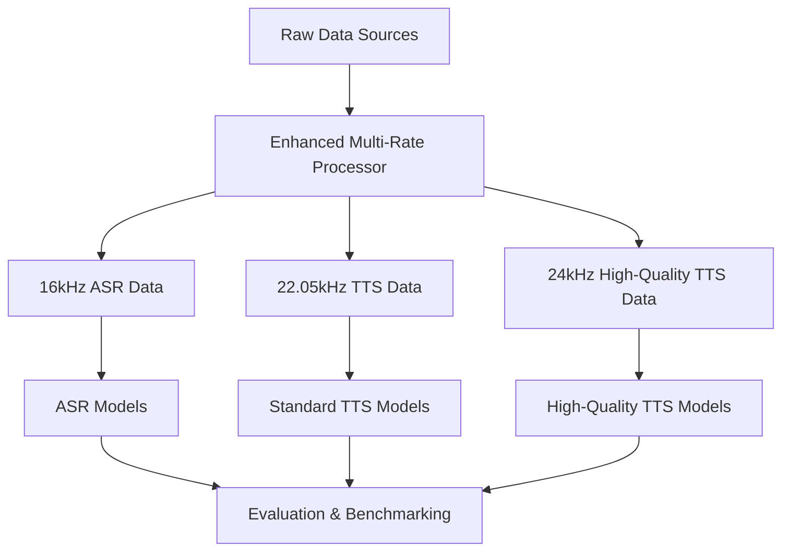

# Enhanced Voice Lab Training Pipeline Documentation

## 📋 Table of Contents
- [Overview](#overview)
- [Architecture & Design](#architecture--design)
- [Platform Setup](#platform-setup)
- [Orchestration & Workflow](#orchestration--workflow)
- [File Structure & Outputs](#file-structure--outputs)
- [Adding New Languages](#adding-new-languages)
- [Adding New Models](#adding-new-models)
- [Adding New Data Sources](#adding-new-data-sources)
- [Troubleshooting](#troubleshooting)
- [Team Onboarding](#team-onboarding)

## 🎯 Overview

The Enhanced Voice Lab Training Pipeline is a comprehensive system for training state-of-the-art voice models for African languages, starting with Twi. It provides:

- **Multi-rate audio processing** optimized for different model types
- **Unified data access** across multiple platforms (Colab, Kaggle, Local)
- **Production-ready training** for ASR and TTS models
- **Language-agnostic framework** for easy adaptation
- **Complete evaluation and benchmarking** tools

### Key Features
- ✅ **10+ model architectures** supported (Whisper, XTTS, OpenVoice, etc.)
- ✅ **3 sample rates** optimized for different use cases
- ✅ **Multiple data sources** with automatic processing
- ✅ **Cross-platform compatibility** (Colab, Kaggle, Local)
- ✅ **Production deployment** ready with comprehensive metrics

---

## 🏗 Architecture & Design

### Data Processing Architecture



### Model Categories by Sample Rate

| Sample Rate | Models | Use Case | Notebooks |
|-------------|---------|----------|-----------|
| **16kHz** | Faster-Whisper, Wav2Vec2, MMS, Moshi | ASR & Speech Recognition | `006-009`, `010_unified_asr_comparison_enhanced.ipynb` |
| **22.05kHz** | Coqui XTTS, MeloTTS | Standard TTS & Voice Cloning | `010_coqui_training_enhanced.ipynb` |
| **24kHz** | OpenVoice, Kokoro, F5-TTS, ChatTTS | High-Quality TTS & Voice Conversion | `015_openvoice_training.ipynb`, `016_vibe_voice_training.ipynb` |

---

## 🖥 Platform Setup

### Google Colab (Recommended)

#### Initial Setup
```python
# 1. Mount Google Drive
from google.colab import drive
drive.mount('/content/drive')

# 2. Set working directory
import os
BASE_PATH = '/content/drive/MyDrive/voice-lab-data/'
os.makedirs(BASE_PATH, exist_ok=True)
os.chdir(BASE_PATH)
```

#### Drive Structure Setup
Create this folder structure in your Google Drive:
```
MyDrive/
└── voice-lab-data/
    ├── raw/                          # Raw datasets
    │   ├── bibletts/
    │   ├── financial_inclusion/
    │   └── michsethowusu/
    ├── processed/                    # Processed outputs
    │   ├── processed_audio/
    │   ├── manifests/
    │   └── model_manifests/
    ├── models/                       # Model checkpoints
    └── output/                       # Training outputs
```

### Kaggle

#### Initial Setup
```python
# Kaggle environment setup
import os
from pathlib import Path

BASE_PATH = Path('/kaggle/working/voice-lab-data')
BASE_PATH.mkdir(parents=True, exist_ok=True)
os.chdir(BASE_PATH)

# Add datasets as Kaggle datasets or upload to working directory
```

### Local Environment

#### Prerequisites
```bash
# Install required packages
pip install torch torchaudio transformers
pip install librosa soundfile pandas numpy tqdm
pip install TTS speechbrain evaluate
pip install jupyter matplotlib seaborn tabulate
```

#### Setup
```python
# Local environment setup
BASE_PATH = Path('/path/to/your/voice-lab-data')
BASE_PATH.mkdir(parents=True, exist_ok=True)
os.chdir(BASE_PATH)
```

---

## 🔄 Orchestration & Workflow

### Complete Workflow Order

#### Phase 1: Data Processing (REQUIRED FIRST)
```
1. Run: final/002_enhanced_multi_rate_data_processing.ipynb
   ├── Processes raw data at multiple sample rates
   ├── Generates quality-filtered datasets
   ├── Creates unified manifests for all model types
   └── Outputs comprehensive statistics
```

#### Phase 2: Model Training (Run in parallel or sequence)

**ASR Models (16kHz)**
```
2a. Run: 006_faster_whisper_training_optimized.ipynb
2b. Run: 007_meta_mms_training_optimized.ipynb  
2c. Run: 008_wav2vec2_training_optimized.ipynb
2d. Run: 009_moshi_full_integration_optimized.ipynb
```

**Standard TTS Models (22.05kHz)**
```
3a. Run: final/010_coqui_training_enhanced.ipynb
3b. Run: 012_meta_mms_tts_optimized.ipynb (if available)
```

**High-Quality TTS Models (24kHz)**
```
4a. Run: 015_openvoice_training.ipynb
4b. Run: 016_vibe_voice_training.ipynb
4c. Run: 011_kokoro_tts_edge_optimized.ipynb
4d. Run: 013_f5_tts_zero_shot.ipynb
4e. Run: 014_chattts_chatterbox.ipynb
```

#### Phase 3: Evaluation & Comparison
```
5. Run: 010_unified_asr_comparison_enhanced.ipynb
   └── Comprehensive benchmarking of all ASR models
```

### Execution Examples

#### Quick Start (Colab)
```python
# 1. Data processing (run once)
%run "/content/drive/MyDrive/voice-lab-data/notebooks/final/002_enhanced_multi_rate_data_processing.ipynb"

# 2. Train specific model (example: Coqui XTTS)
%run "/content/drive/MyDrive/voice-lab-data/notebooks/final/010_coqui_training_enhanced.ipynb"

# 3. Evaluate ASR models
%run "/content/drive/MyDrive/voice-lab-data/notebooks/010_unified_asr_comparison_enhanced.ipynb"
```

#### Batch Processing Script
```python
# batch_train_all.py
import subprocess
import sys

notebooks = [
    "final/002_enhanced_multi_rate_data_processing.ipynb",
    "final/010_coqui_training_enhanced.ipynb", 
    "015_openvoice_training.ipynb",
    "016_vibe_voice_training.ipynb",
    "010_unified_asr_comparison_enhanced.ipynb"
]

for notebook in notebooks:
    print(f"Running {notebook}...")
    result = subprocess.run([
        sys.executable, "-m", "jupyter", "nbconvert", 
        "--execute", "--to", "notebook", "--inplace", notebook
    ], capture_output=True, text=True)
    
    if result.returncode == 0:
        print(f"✅ {notebook} completed successfully")
    else:
        print(f"❌ {notebook} failed: {result.stderr}")
```

---

## 📁 File Structure & Outputs

### Processed Data Structure
After running the data processing pipeline:

```
processed/
├── processed_audio/
│   ├── asr_16k/                     # 16kHz audio for ASR models
│   │   ├── bibletts_speaker001_001.wav
│   │   ├── fisd_speaker002_001.wav
│   │   └── michset_speaker003_001.wav
│   ├── tts_22k/                     # 22.05kHz audio for TTS models
│   │   └── [same structure as asr_16k]
│   └── tts_24k/                     # 24kHz audio for high-quality TTS
│       └── [same structure as asr_16k]
├── manifests/
│   ├── asr_16k_dataset.csv         # Master ASR dataset
│   ├── tts_22k_dataset.csv         # Master TTS dataset
│   └── tts_24k_dataset.csv         # Master high-quality TTS dataset
├── model_manifests/
│   ├── faster_whisper_train.csv    # Model-specific training data
│   ├── faster_whisper_val.csv      # Model-specific validation data
│   ├── coqui_xtts_train.txt        # Coqui-format training data
│   ├── openvoice_train.csv         # OpenVoice training data
│   └── [additional model-specific manifests]
├── temp_audio/                      # Temporary extracted audio
└── statistics.json                  # Processing statistics
```

### Model Output Structure
Each model training creates:

```
models/
├── [model_name]/
│   ├── checkpoints/                 # Model checkpoints
│   ├── config.json                  # Training configuration
│   ├── logs/                        # Training logs
│   └── speaker_embeddings.pkl      # Speaker embeddings (if applicable)
```

### Results Structure
Evaluation outputs:

```
results/
├── asr_comparison/
│   ├── enhanced_benchmark_results.json
│   ├── enhanced_benchmark_metrics.csv
│   ├── enhanced_benchmark_report.md
│   └── visualizations/
│       ├── enhanced_model_comparison.png
│       └── speed_accuracy_analysis.png
└── model_specific_results/
    └── [individual model results]
```

### Key Files Explained

| File | Description | Usage |
|------|-------------|-------|
| `asr_16k_dataset.csv` | Master ASR dataset with processed 16kHz audio | Load for ASR model training |
| `tts_22k_dataset.csv` | Master TTS dataset with processed 22.05kHz audio | Load for standard TTS training |
| `coqui_xtts_train.txt` | Coqui-specific format: `path\|text\|speaker` | Direct Coqui TTS training |
| `statistics.json` | Processing statistics and metadata | Quality assessment |
| `enhanced_benchmark_report.md` | Comprehensive evaluation report | Performance analysis |

---

## 🌍 Adding New Languages

### Step-by-Step Process

#### 1. Data Preparation
```python
# Add language-specific datasets to the configuration
datasets_to_scan = [
    {
        "name": "your_language_dataset",
        "type": "bibletts",  # or "financial_inclusion" or "arrow_sharded_audio"
        "path": "raw/your_language_data"
    }
]
```

#### 2. Update Text Processing
```python
# Modify the EnhancedTwiTextProcessor for your language
class EnhancedYourLanguageTextProcessor(EnhancedTwiTextProcessor):
    def __init__(self, dialect='standard'):
        super().__init__(dialect)
        
        # Add language-specific characters
        self.language_chars = {'ą', 'ć', 'ę', 'ł', 'ń', 'ó', 'ś', 'ź', 'ż'}  # Example for Polish
        
        # Update number conversion
        self.number_processor = YourLanguageNumberProcessor()
        
    def clean_text(self, text: str) -> str:
        # Add language-specific text cleaning
        text = super().clean_text(text)
        # Add your language-specific processing here
        return text
```

#### 3. Model Configuration Updates
```python
# Update model configurations for new language
model_configs = {
    'faster_whisper': {
        'language_code': 'your_lang_code',  # e.g., 'pl' for Polish
        'model_path': 'openai/whisper-small',
    },
    'mms': {
        'language_code': 'your_lang_code',
        'adapter': 'your_lang_code'  # MMS language adapter
    }
}
```

#### 4. Create Language-Specific Notebooks
Copy and modify existing notebooks:
```bash
# Copy base notebooks
cp final/002_enhanced_multi_rate_data_processing.ipynb your_language/002_your_lang_processing.ipynb
cp final/010_coqui_training_enhanced.ipynb your_language/010_your_lang_coqui.ipynb

# Update language codes, text processing, and dataset paths
```

#### 5. Validation Checklist
- [ ] Text processor handles language-specific characters
- [ ] Number conversion works for your language
- [ ] Audio quality is validated
- [ ] Model language settings are correct
- [ ] Evaluation metrics are appropriate

### Language Adaptation Template
```python
# Template for new language integration
LANGUAGE_CONFIG = {
    'name': 'Your Language Name',
    'code': 'your_lang',
    'family': 'language_family',
    'speakers': estimated_speakers,
    'writing_system': 'latin/arabic/etc',
    'special_chars': {'char1', 'char2'},
    'phoneme_count': approximate_count,
    'datasets': [
        {
            'name': 'dataset1',
            'type': 'bibletts',
            'path': 'raw/dataset1'
        }
    ],
    'models': {
        'whisper_lang': 'whisper_language_code',
        'mms_adapter': 'mms_language_code'
    }
}
```

---

## 🤖 Adding New Models

### Step-by-Step Process

#### 1. Create Model Interface
```python
# Add to the model interfaces file
class YourNewModelInterface(EnhancedASRModelInterface):
    """Interface for YourNewModel."""
    
    def load_model(self):
        try:
            # Load your model here
            from your_model_library import YourModel
            
            self.model = YourModel.from_pretrained(self.config['model_path'])
            if self.device == 'cuda':
                self.model = self.model.cuda()
            
            self.loaded = True
            print(f"✅ Loaded {self.config['name']}")
            
        except Exception as e:
            print(f"❌ Failed to load {self.config['name']}: {e}")
            self.loaded = False
    
    def _do_transcribe(self, audio_path: str) -> str:
        # Load audio at appropriate sample rate
        audio, sr = librosa.load(audio_path, sr=self.config.get('sample_rate', 16000))
        
        # Process audio through your model
        with torch.no_grad():
            result = self.model.transcribe(audio)
        
        return result.text.strip()
```

#### 2. Update Model Factory
```python
# Add to EnhancedModelFactory
@staticmethod
def create_model(model_key: str, config: EnhancedASRConfig) -> EnhancedASRModelInterface:
    model_config = config.models[model_key]
    model_type = model_config['type']
    
    # Add your model type
    if model_type == 'your_new_model':
        return YourNewModelInterface(model_config)
    # ... existing models
```

#### 3. Update Configuration
```python
# Add model to configuration
self.models = {
    # ... existing models
    'your_new_model': {
        'name': 'Your New Model Name',
        'model_path': 'huggingface/model/path',
        'type': 'your_new_model',
        'color': '#FF6B6B',
        'description': 'Description of your model',
        'sample_rate': 16000,  # or appropriate rate
        'category': 'asr'  # or 'tts'
    }
}
```

#### 4. Create Training Notebook
```python
# Create: XXX_your_model_training.ipynb
# Use existing notebooks as templates

# Key components to include:
class YourModelTrainer:
    def __init__(self, config, dataset):
        self.config = config
        self.dataset = dataset
    
    def prepare_training_data(self):
        # Convert data to your model's format
        pass
    
    def train_model(self):
        # Implement training loop
        pass
    
    def evaluate_model(self):
        # Implement evaluation
        pass
```

#### 5. Update Evaluation Pipeline
Add your model to the comparison notebooks:
```python
# Update model lists in comparison notebooks
models_to_evaluate = [
    'faster_whisper',
    'mms', 
    'wav2vec2',
    'your_new_model'  # Add here
]
```

### Model Integration Checklist
- [ ] Model interface implemented
- [ ] Factory updated
- [ ] Configuration added
- [ ] Training notebook created
- [ ] Evaluation integration added
- [ ] Documentation updated
- [ ] Testing completed

---

## 📊 Adding New Data Sources

### Supported Data Formats

#### 1. BiblTTS Format
- Audio files with co-located `.txt` files
- Structure: `audio_file.wav` + `audio_file.txt`

#### 2. Financial Inclusion Format  
- Audio in `audios/` subfolder
- Manifest as `data.csv` with path and text columns

#### 3. Arrow Sharded Audio
- Arrow files with embedded audio: `data-*.arrow`
- Columns: `audio`, `transcript`/`text`, `speaker_id`

#### 4. Common Voice Format
- TSV files with `path` and `sentence` columns
- Audio in separate directory

### Adding Custom Data Source

#### 1. Create Scanner Function
```python
def _scan_your_format(self, dataset_path: Path, dataset_name: str) -> List[Dict]:
    """Scanner for your custom format."""
    samples = []
    
    # Your format-specific logic here
    # Example for CSV with audio_file, text, speaker columns:
    csv_file = dataset_path / 'manifest.csv'
    if csv_file.exists():
        df = pd.read_csv(csv_file)
        
        for _, row in df.iterrows():
            audio_path = dataset_path / 'audio' / row['audio_file']
            if audio_path.exists():
                samples.append({
                    'audio_path': str(audio_path),
                    'text': row['text'],
                    'speaker_id': row.get('speaker', 'unknown'),
                    'language': 'tw',  # or detect from data
                    'dataset': dataset_name
                })
    
    return samples
```

#### 2. Update Data Loader
```python
# Add to MultiRateDataLoader.scan_all_datasets()
if dataset_config['type'] == 'your_format':
    samples = self._scan_your_format(dataset_path, dataset_config['name'])
```

#### 3. Update Configuration
```python
datasets_to_scan = [
    # ... existing datasets
    {
        "name": "your_dataset",
        "type": "your_format", 
        "path": "raw/your_dataset"
    }
]
```

### Data Quality Guidelines

#### Audio Requirements
- **Sample Rate**: Original (will be resampled automatically)
- **Format**: WAV, MP3, FLAC, OGG supported
- **Duration**: 0.5-30 seconds (configurable)
- **Quality**: Clear speech, minimal noise

#### Text Requirements  
- **Encoding**: UTF-8
- **Length**: 5-500 characters (configurable)
- **Content**: Clean transcriptions matching audio
- **Language**: Consistent with target language

#### Metadata Requirements
- **Speaker ID**: Unique identifier per speaker
- **Dataset Name**: Consistent naming
- **Language Code**: ISO language code preferred

---

## 🔧 Troubleshooting

### Common Issues & Solutions

#### 1. Memory Issues
**Problem**: CUDA out of memory during training
**Solutions**:
```python
# Reduce batch size
config.batch_size = 1

# Use gradient accumulation
config.gradient_accumulation_steps = 4

# Enable CPU offloading
config.cpu_offload = True
```

#### 2. Data Loading Issues
**Problem**: Audio files not found or corrupted
**Solutions**:
```python
# Check file existence
def validate_dataset(df):
    existing = df['audio_path'].apply(lambda x: Path(x).exists())
    print(f"Valid files: {existing.sum()}/{len(df)}")
    return df[existing]

# Test audio files
def test_audio_file(audio_path):
    try:
        info = sf.info(audio_path)
        print(f"✅ {audio_path}: {info.duration:.1f}s, {info.samplerate}Hz")
        return True
    except Exception as e:
        print(f"❌ {audio_path}: {e}")
        return False
```

#### 3. Model Loading Issues
**Problem**: Model fails to load
**Solutions**:
```python
# Check dependencies
import pkg_resources
required_packages = ['transformers', 'torch', 'torchaudio']
for package in required_packages:
    try:
        pkg_resources.get_distribution(package)
        print(f"✅ {package} installed")
    except:
        print(f"❌ {package} missing - install with: pip install {package}")

# Test model loading
try:
    from transformers import AutoModel
    model = AutoModel.from_pretrained("model_path")
    print("✅ Model loads successfully")
except Exception as e:
    print(f"❌ Model loading failed: {e}")
```

#### 4. Platform-Specific Issues

**Google Colab**:
```python
# Runtime disconnection
# Solution: Save checkpoints frequently
if step % save_interval == 0:
    torch.save(model.state_dict(), f'checkpoint_{step}.pt')

# Quota exceeded
# Solution: Use smaller datasets or reduce processing frequency
```

**Kaggle**:
```python
# Time limits
# Solution: Use dataset snapshots and incremental processing
import kaggle
kaggle.api.dataset_create_version(folder, version_notes="Processed data")
```

### Debug Mode Activation
```python
# Enable debug mode for detailed logging
import logging
logging.basicConfig(level=logging.DEBUG)

# Add debug prints in training loops
if debug_mode:
    print(f"Step {step}: Loss {loss:.4f}, GPU Memory: {torch.cuda.memory_allocated()/1e9:.1f}GB")
```

---

## 👥 Team Onboarding

### New Team Member Checklist

#### Week 1: Environment Setup
- [ ] Set up Google Colab/Kaggle/Local environment
- [ ] Clone repository and run setup scripts
- [ ] Execute `final/002_enhanced_multi_rate_data_processing.ipynb`
- [ ] Verify all outputs and file structure
- [ ] Run one complete training example (e.g., Coqui XTTS)

#### Week 2: Understanding Architecture
- [ ] Review architecture diagrams and data flow
- [ ] Understand sample rate categorization
- [ ] Study model interfaces and factory patterns
- [ ] Examine evaluation metrics and benchmarking
- [ ] Practice modifying configurations

#### Week 3: Hands-on Development
- [ ] Add a new data source (practice)
- [ ] Modify text processing for edge cases
- [ ] Train a model end-to-end
- [ ] Run comprehensive evaluations
- [ ] Create visualizations and reports

### Key Concepts to Master

#### 1. Data Pipeline Flow
```
Raw Data → Multi-Rate Processing → Model-Specific Manifests → Training → Evaluation
```

#### 2. Configuration Management
- Understand sample rate mapping
- Model-specific parameters
- Platform adaptations

#### 3. Error Handling Patterns
- Robust file loading
- Memory management
- Platform compatibility

#### 4. Evaluation Methodology
- WER/CER calculation
- Real-time factor (RTF)
- Speed-accuracy tradeoffs

### Development Best Practices

#### Code Standards
```python
# Always include comprehensive error handling
try:
    result = risky_operation()
    return result
except Exception as e:
    logger.error(f"Operation failed: {e}")
    return fallback_value

# Use consistent naming conventions
def process_audio_for_model_type(audio_path: str, model_type: str) -> str:
    """Process audio file for specific model type."""
    pass

# Document all functions
def calculate_wer(predictions: List[str], references: List[str]) -> float:
    """
    Calculate Word Error Rate between predictions and references.
    
    Args:
        predictions: List of predicted transcriptions
        references: List of reference transcriptions
        
    Returns:
        WER as float between 0 and 1
    """
```

#### Testing Approach
```python
# Test with small datasets first
test_config = Config()
test_config.test_size = 10  # Small test set
test_config.max_duration = 5.0  # Short audio clips

# Validate each step
def validate_processing_step(input_data, output_data, step_name):
    assert len(input_data) > 0, f"{step_name}: No input data"
    assert len(output_data) > 0, f"{step_name}: No output data"
    print(f"✅ {step_name}: {len(input_data)} → {len(output_data)}")
```

### Resources for Learning

#### Essential Papers & Documentation
- **Whisper**: "Robust Speech Recognition via Large-Scale Weak Supervision"
- **MMS**: "Scaling Speech Technology to 1,000+ Languages"  
- **Wav2Vec2**: "wav2vec 2.0: A Framework for Self-Supervised Learning"
- **XTTS**: Coqui TTS documentation and papers

#### Code Examples & Tutorials
- HuggingFace Transformers tutorials
- PyTorch Audio processing guides
- TTS training best practices
- African NLP resources and datasets

#### Community & Support
- African NLP community forums
- Speech processing research groups
- Open source TTS/ASR projects
- Technical mentorship programs

---

## 📞 Support & Contact

### Getting Help

#### 1. Self-Service Resources
- Check this documentation first
- Review error logs and troubleshooting section
- Test with smaller datasets
- Validate environment setup

#### 2. Team Support
- Post issues in team chat/forum
- Share error logs and configurations
- Provide reproducible examples
- Tag relevant team members

#### 3. Development Guidelines
- Follow coding standards
- Write comprehensive tests
- Document all changes
- Review before merging

### Contributing Guidelines

#### Pull Request Process
1. **Branch**: Create feature branch from main
2. **Test**: Run full pipeline on test data
3. **Document**: Update documentation
4. **Review**: Submit for team review
5. **Merge**: Merge after approval

#### Quality Standards
- All notebooks must run end-to-end
- Error handling for all external dependencies
- Platform compatibility (Colab, Kaggle, Local)
- Comprehensive documentation
- Performance benchmarks

---

**Last Updated**: January 2025  
**Version**: 2.0 Enhanced Pipeline  
**Maintainer**: Voice Lab Team

*This documentation is living and should be updated as the pipeline evolves. All team members are encouraged to contribute improvements and corrections.*